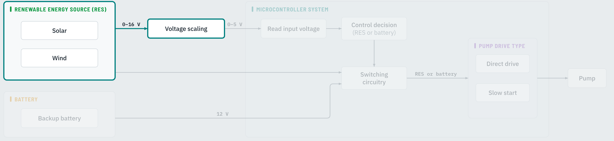
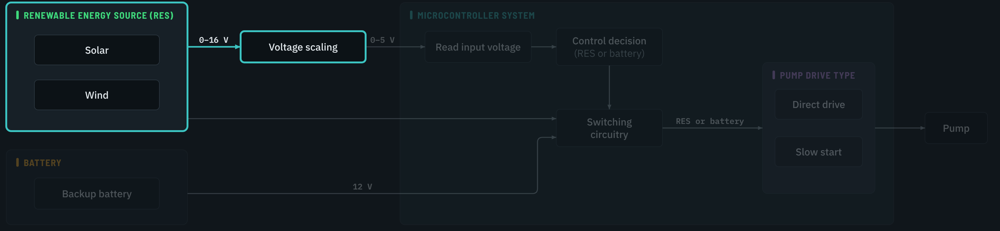

# Voltage measurement

The first block after the renewable energy source (RES) in the
[project overview](../project-overview.qmd) is **voltage scaling**. Its job
is to bring the RES voltage, which can be anywhere from 0 V to about 16 V, into
the 0–5 V range that an Arduino analogue input can safely measure. This chapter
explains why that matters, how a **voltage divider** does it, and how to set
up an adjustable divider safely.

```{=html}
<figure class="flow-diagram">
<figcaption>System overview · Voltage scaling</figcaption>
<a class="fd-light" href="images/system-voltage-scaling-light.png"></a>
<a class="fd-dark" href="images/system-voltage-scaling-dark.png"></a>
</figure>
```

## Learning outcomes

By the end of this chapter you should be able to:

- Explain why a varying source voltage must be scaled before an Arduino can measure it
- Tell the difference between scaling a voltage for **measurement** and regulating a supply for **power**
- Calculate the current and output voltage of a voltage divider
- Choose divider resistors from a source's maximum voltage
- Work out the current and power a resistor choice gives, and pick a safe standard value
- Size an LED's series resistor from its forward voltage, and explain why the supply must leave enough voltage for the resistor
- Use a potentiometer as an adjustable divider, and set one up safely to monitor a source

---

## 1. Why the voltage has to be brought into range

The renewable source in the project is a solar panel and a wind turbine. Its
voltage changes with the sun and the wind, from 0 V when everything is still up
to about **16 V**. The Arduino needs to know that voltage to decide whether the
pump can run from the RES or must switch to the battery.

The problem is the Arduino's analogue inputs:

- They measure **0 to 5 V** only. Anything above 5 V reads as the maximum, 1023,
  so 6 V and 16 V look the same.
- Above about **5.5 V** the input is outside the chip's absolute maximum rating.
  The pin's protection diodes start to conduct, and enough current through them
  damages the ATmega328P, sometimes the whole board.
- Below 0 V (a reversed source) is just as harmful.

So the RES must never be connected straight to an analogue pin. Something has to
sit between them that turns 0–16 V into 0–5 V, **in proportion**, so the
Arduino can still tell a weak source from a strong one.

### Measuring is not the same as powering

This block **measures** the RES voltage; it doesn't **regulate** it. The two are
easily confused, and the project needs to keep them apart:

| | Scaling for **measurement** | Regulating for **power** |
|---|---|---|
| Purpose | Tell the Arduino how big the RES voltage is | Give a circuit a steady supply whatever the input does |
| Output | A fixed **fraction** of the input: it rises and falls with it | A **constant** voltage (e.g. 5 V) while the input is high enough |
| Typical part | Voltage divider (two resistors, or a potentiometer) | Linear regulator (e.g. 7805) or a switch-mode converter |
| Current it can supply | Almost none: microamps to a milliamp | Up to its rating (hundreds of mA or more) |

A regulator would be no use for monitoring: its output stays at 5 V whatever the
RES does, so the Arduino would learn nothing. A divider is no use for powering
anything: as soon as a load draws current from it, its output collapses. The
Arduino Uno has its own **5 V linear regulator** for its supply (7–12 V on the
barrel jack or Vin); above about 12 V that regulator wastes
$P = (V_{in} - 5)\,I$ as heat. The **voltage scaling** block in the project
is a divider, not a regulator.

### Using the whole range

The ADC divides 0–5 V into 1024 steps of about 4.9 mV. If the divider is
designed so the RES **maximum** gives just under 5 V, the whole range is used and
each step is as small as possible at the source. A divider that gives only
2.5 V at the RES maximum would throw half of those steps away.

---

## 2. Ohm's law and resistors in series

$$V = IR$$


**One resistor:** $V_s = 12\ \text{V}$, $R = 330\ \Omega$, so $I = \dfrac{12}{330} = 36\ \text{mA}$.

**Two resistors in series:** the resistances add, $R_T = R_1 + R_2$. With
$R_1 = R_2 = 330\ \Omega$, $R_T = 660\ \Omega$ and $I = \dfrac{12}{660} = 18.2\ \text{mA}$:
half the current, because there is twice the resistance.

The voltage across each resistor is $V = IR$ for that resistor:
$V_1 = (18.2\times10^{-3})(330) = 6\ \text{V}$, and the same across $R_2$. The two
add up to the 12 V supply.

---

## 3. The voltage divider

A **voltage divider** is two resistors in series across a supply, with an output
taken from the point **between** them. Measured from ground (the bottom of
$R_2$), that point sits at a fixed **fraction** of the supply voltage.


### How it works, in three steps

1. **The same current flows through both resistors.** There is only one path, so
   the current is set by the total resistance:
   $$I = \frac{V_s}{R_1 + R_2} = \frac{12\ \text{V}}{660\ \Omega} = 18.2\ \text{mA}$$
2. **Each resistor takes a share of the supply voltage, in proportion to its
   resistance.** With the same current through both, $V = IR$ means the bigger
   resistor drops the bigger voltage. Here they are equal, so each takes half:
   $V_1 = V_2 = 6\ \text{V}$. The shares always add up to $V_s$.
3. **The output is the voltage across $R_2$.** Substituting $I$ from step 1 into
   $V_{out} = I R_2$:
   $$\boxed{V_{out} = V_s\,\frac{R_2}{R_1 + R_2}}$$

**An analogy:** think of water flowing through a pipe with two narrow sections in
a row. The same flow passes through both, and the pressure drops a little across
each. The pressure between the two narrow sections depends only on how
restrictive each one is compared with the other. In a divider, voltage plays the
part of pressure, current the part of flow, and resistance the part of the
narrow sections.

### A worked example with unequal resistors

$V_s = 9\ \text{V}$, $R_1 = 330\ \Omega$, $R_2 = 100\ \Omega$:


$$I = \frac{9}{430} = 20.9\ \text{mA}, \qquad V_{out} = 20.9\ \text{mA}\times100\ \Omega = 2.09\ \text{V}$$

> ⚠️ Always recalculate the current for each new pair of resistors. Reusing a
> current from an earlier example (say 20 mA) gives 2.0 V here, not 2.09 V. Keep
> full values until the last step.

### The ratio is what matters

$V_{out}$ depends only on the **ratio** of the resistors, not on their actual
values:

| $R_1 : R_2$ | Fraction $\dfrac{R_2}{R_1+R_2}$ | $V_{out}$ from 12 V |
|---|---|---|
| 1 : 1 | 1/2 | 6 V |
| 2 : 1 | 1/3 | 4 V |
| 1 : 2 | 2/3 | 8 V |
| 3 : 1 | 1/4 | 3 V |

- **The total resistance sets the current**, and so the power wasted as heat.
  330 Ω + 330 Ω and 33 kΩ + 33 kΩ both give 6 V, but the second draws a hundred
  times less current. For a circuit that only *measures* a voltage, use large
  values.
- **$V_{out}$ is always between 0 and $V_s$.** A divider can only reduce a
  voltage, never increase it.
- **Don't draw current from the output.** Anything connected to $V_{out}$ takes
  some current and pulls the output down. An Arduino analogue input draws almost
  nothing, so a divider is ideal for **measuring** a voltage, and useless for
  powering a load.

The **Analyse** tab of the voltage divider lab (in Section 4) works out the
current, output voltage, power and `analogRead()` value for any divider.

---

## 4. Choosing the resistors for the RES

Design from the **maximum** voltage the source can produce, and the voltage you
want at the Arduino at that maximum (5 V). In this example the RES has a maximum
voltage of **15.86 V**:

$$5\ \text{V} = 15.86\ \text{V}\left(\frac{R_2}{R_1+R_2}\right)$$

$$5(R_1 + R_2) = 15.86\,R_2 \quad\Rightarrow\quad 5R_1 = 10.86\,R_2$$

$$\boxed{R_1 = 2.172\,R_2}$$

In general, for a maximum source voltage $V_{max}$:

$$R_1 = \left(\frac{V_{max}}{5} - 1\right)R_2$$

Now choose a convenient $R_2$ and calculate $R_1$:

| $R_2$ | $R_1 = 2.172R_2$ | Nearest standard $R_1$ | $V_{out}$ at 15.86 V | Current |
|---|---|---|---|---|
| 1 kΩ | 2.172 kΩ | 2.2 kΩ | 4.96 V | 5.0 mA |
| 10 kΩ | 21.72 kΩ | 22 kΩ | 4.96 V | 0.50 mA |
| 100 kΩ | 217.2 kΩ | 220 kΩ | 4.96 V | 0.05 mA |

- Round $R_1$ **up** to a standard value so that $V_{out}$ stays just under 5 V.
- Larger resistances waste less energy, which matters in a *sustainable* system.
  But very large values (well over 10 kΩ in total) make the Arduino's reading
  noisier, because the ADC needs a little current to charge its sampling
  capacitor. **Around 10 kΩ for $R_2$** is a good compromise.
- The result is only as accurate as the resistors: ±5 % parts give up to ±5 %
  error in the measured RES voltage. Measure the real values with a multimeter
  and use those in your code.

> 🔧 **Try it:** [Voltage divider lab](applets/voltage-divider.html) — the **Scale** tab takes your source's maximum voltage and gives $R_1$ as a multiple of $R_2$, exactly as above; **Analyse** and **Design** check any divider.

---

## 5. Current: choosing the right resistor value

Every resistor you choose sets a **current**, and the current decides whether the
circuit works, how much energy it wastes, and whether anything overheats:

$$I = \frac{V}{R}, \qquad P = I^2R = \frac{V^2}{R}$$

- **Too little resistance** means too much current. The parts heat up ($P = I^2R$),
  a resistor beyond its power rating burns, an LED or a pin is destroyed, and a
  battery drains fast.
- **Too much resistance** means too little current. An LED is dim or dark, and a
  measurement divider with very large values gives a noisy `analogRead`.
- **Resistors come in standard values** (the E12 series: 10, 12, 15, 18, 22, 27, 33,
  39, 47, 56, 68, 82, and those × 10, × 100 …), so a calculated value has to be
  rounded. Round in the **safe** direction: to the next value up when the current
  must not exceed a limit.
- **Resistors have a power rating** (¼ W is common). Keep the power well inside it:
  using no more than half the rating is a good rule.

### Current in the measurement divider

A divider across the RES draws current all the time, whether or not anyone is
reading it. At the RES maximum of 16 V:

| Divider | Total resistance | Current | Power wasted | Charge per day |
|---|---|---|---|---|
| 220 Ω + 100 Ω | 320 Ω | 50 mA | 0.8 W | 1.2 Ah |
| 2.2 kΩ + 1 kΩ | 3.2 kΩ | 5 mA | 80 mW | 0.12 Ah |
| 22 kΩ + 10 kΩ | 32 kΩ | 0.5 mA | 8 mW | 0.012 Ah |

All three give the same 5 V at the pin, because the ratio is the same. The first
wastes almost a watt, more than three ¼ W resistors could handle, and in a day
uses as much charge as a small battery holds. The last wastes almost nothing.
That is why Section 4 recommends around 10 kΩ for $R_2$.

### Current through an LED

An LED is the clearest example of why the resistor value matters.


- **Polarity.** The **anode** (+, long leg) must be at the higher voltage and the
  **cathode** (−, short leg, flat edge on the lens) at the lower. Reversed, an LED
  doesn't conduct, and most are only rated to about 5 V in reverse.
- **It can't limit its own current.** An LED is a diode: its current rises
  **exponentially** with voltage. A change of a few tens of millivolts across it
  changes the current several times over, so connected straight to a supply the
  current is limited only by the supply's internal resistance, and the LED burns
  out within seconds. The **series resistor** sets the current.

### Forward voltage

Once an LED is conducting, the voltage across it stays roughly constant at its
**forward voltage**, $V_f$. The rest of the supply voltage, $V_s - V_f$, is across
the resistor, so:

$$I = \frac{V_s - V_f}{R} \qquad\Longrightarrow\qquad R = \frac{V_s - V_f}{I_F}$$

where $I_F$ is the current you want (typically 10–20 mA; most small LEDs are rated
at 20 mA, with a 30 mA maximum). $V_f$ depends mainly on the **colour**, because
it is set by the semiconductor material:

| LED colour | Typical $V_f$ | Resistor for ≤ 20 mA from 5 V | Resistor for ≤ 20 mA from 9 V |
|---|---|---|---|
| Red | 2.0 V | 150 Ω (20.0 mA) | 390 Ω (17.9 mA) |
| Yellow | 2.1 V | 150 Ω (19.3 mA) | 390 Ω (17.7 mA) |
| Green (standard) | 2.2 V | 150 Ω (18.7 mA) | 390 Ω (17.4 mA) |
| Blue, white, bright green | 3.2 V | 100 Ω (18.0 mA) | 330 Ω (17.6 mA) |

**Worked example:** a 9 V supply and a red LED at 20 mA:
$R = (9 - 2)/0.020 = 350\ \Omega$, which is not a standard value. Round **up** to
390 Ω, giving 17.9 mA. Rounding down to 330 Ω would give 21.2 mA, over the rating.

### Leave enough voltage for the resistor

$V_f$ is only a typical figure. It varies from one LED to the next (often
±0.2 V), and it falls slightly as the LED warms up. The resistor's voltage,
$V_s - V_f$, absorbs that variation, so the more voltage is left for the
resistor, the less the current changes:

| Supply and LED | Left for the resistor | Current change if $V_f$ is 0.2 V lower |
|---|---|---|
| 9 V, red | 7 V | about 3 % |
| 5 V, red | 3 V | about 7 % |
| 5 V, white | 1.8 V | about 11 % |
| 3.3 V, white | 0.1 V | **current doubles or more**: unpredictable |

Keep at least a volt or two across the resistor. A white or blue LED from a 3.3 V
supply leaves almost nothing, so its brightness depends on the individual LED;
use the 5 V supply instead.

**Power check.** The resistor also dissipates power: at 390 Ω and 17.9 mA,
$P = I^2R = 0.0179^2 \times 390 \approx 125$ mW, half of a ¼ W rating.

> ▶️ **[LED circuit explorer](applets/led-circuit.html)** — choose a supply and LED colour, slide through the standard resistor values and watch the current. Pick a resistor that is too small and the LED burns out.

**Try these:** (if the LED burns out, move the slider to a larger resistor
first, then press **Replace the LED**)

1. With the **9 V battery** and a **red LED**, find the smallest standard
   resistor that keeps the current at or below 20 mA.
2. Slide all the way to **no resistor**. What happens, and why?
3. Switch to a **blue LED**. Why does the smallest safe resistor change?
4. At the resistor you found in task 1, how much power does the resistor
   dissipate? Is a standard ¼ W resistor enough?
5. Try the **3.3 V** supply with a **white LED**. The explorer finds a resistor
   that works, so why is this still a poor combination?

<details>
<summary>Answers</summary>

1. **390 Ω.** Exactly 20 mA needs $R = (9 - 2.0)/0.020 = 350\ \Omega$, which is not a standard value. The next E12 value up is 390 Ω, giving $(9 - 2.0)/390 = 17.9\ \text{mA}$.
2. With no resistor, only the battery's small internal resistance limits the current, so it tries to reach amps, far past the 30 mA maximum, and the LED burns out.
3. A blue LED has a higher forward voltage (3.2 V), so the resistor has less voltage across it: $(9 - 3.2)/0.020 = 290\ \Omega$, so the smallest safe standard value is **330 Ω**.
4. $P = V_R^2/R = 7^2/390 \approx 126\ \text{mW}$: about half of a ¼ W (250 mW) rating, which is acceptable.
5. Only $3.3 - 3.2 = 0.1\ \text{V}$ is left across the resistor. The explorer recommends 10 Ω because it assumes $V_f$ is exactly 3.2 V. Real white LEDs vary from about 3.0 to 3.4 V: at 3.0 V a 10 Ω resistor passes $(3.3 - 3.0)/10 = 30\ \text{mA}$, the maximum, and at 3.4 V the LED doesn't light at all. Use the 5 V supply instead.

</details>

---

## 6. Designing for a set current

Sometimes you are given the output voltage **and** the current. *Design a
voltage divider with an output of 6 V and a current of 60 mA from a 12 V
battery.*


1. Total resistance: $R_T = \dfrac{V_s}{I} = \dfrac{12\ \text{V}}{0.06\ \text{A}} = 200\ \Omega$
2. $V_{out}$ is the voltage across $R_2$, so $R_2 = \dfrac{V_{out}}{I} = \dfrac{6\ \text{V}}{0.06\ \text{A}} = 100\ \Omega$
3. $R_1 = R_T - R_2 = 100\ \Omega$

As a check: 6 V is half of 12 V, so the ratio must be 1 : 1, and it is.

> ⚠️ Watch the units: 60 mA is **0.06 A**, not 0.06 mA.
>
> Each 100 Ω resistor dissipates $P = I^2R = 0.06^2\times100 = 0.36\ \text{W}$,
> more than a standard ¼ W resistor can handle. Use ½ W resistors, or larger
> values and a lower current. For measurement, the lower current is the better
> choice.

The **Design** tab of the voltage divider lab (in Section 4) reproduces this
calculation for any $V_s$, $V_{out}$ and $I$.

---

## 7. Potentiometers: an adjustable divider

A **potentiometer** ("pot") is a **voltage divider whose split you adjust by
turning a knob**. A small one adjusted with a screwdriver is called a
**trimmer**.


It has three pins. The two outer pins are the ends of a resistive track of fixed
resistance ($R_{tot}$, here 5 kΩ). The middle pin is the **wiper**, which touches
the track and divides it into $R_1$ (above the wiper) and $R_2$ (below it):


| Knob position | $R_1$ | $R_2$ |
|---|---|---|
| Turned fully one way | $R_{tot} = 5\ \text{k}\Omega$ | 0 |
| Turned fully the other way | 0 | $R_{tot} = 5\ \text{k}\Omega$ |
| Middle | 2.5 kΩ | 2.5 kΩ |

(Which way counts as "clockwise" depends on which outer pin goes to the supply;
swap them and the direction reverses.)

With 5 V across a 5 kΩ pot, it is exactly the divider from Section 3:


$$I = \frac{5\ \text{V}}{5\ \text{k}\Omega} = 1\ \text{mA}, \qquad V_{out} = I \times R_2$$

- $R_2 = 0$: $V_{out} = 1\ \text{mA}\times0 = 0\ \text{V}$
- $R_2 = 5\ \text{k}\Omega$: $V_{out} = 1\ \text{mA}\times5\ \text{k}\Omega = 5\ \text{V}$

The current stays at 1 mA wherever the knob is, because $R_1 + R_2$ is always
5 kΩ. Only the split changes. On the bench, a pot across 5 V is a handy stand-in
for the RES: turning it lets you test your monitoring code at your desk, as in
[Read input voltage](03-read-input-voltage.md).

---

## 8. Setting an adjustable divider safely

A common way to monitor a source is a **fixed resistor in series with a
trimmer**: the fixed resistor $R_F$ goes from the source to the top of the
trimmer, the bottom of the trimmer goes to ground, and the trimmer's wiper goes
to the analogue pin. The divider's "top" resistor is then $R_F$ plus the part of
the track above the wiper, and the "bottom" resistor is the part below it. With a
trimmer of total resistance $R_T$ and $R_{low}$ below the wiper:

$$V_{pin} = V_{RES}\,\frac{R_{low}}{R_F + R_T}$$

Turning the trimmer changes $R_{low}$ from 0 to $R_T$, so the fraction at the
pin can be anything from 0 up to $R_T/(R_F + R_T)$.

> ⚠️ **Set the trimmer before you trust the reading.** With $R_F$ = 10 kΩ and a
> 10 kΩ trimmer, the largest fraction is $10/(10+10) = 0.5$: a 16 V RES would put
> **8 V** on the pin with the trimmer turned fully up, well over the 5 V limit.
>
> 1. Connect the largest voltage the RES can produce (or a bench supply set to it,
>    e.g. 16 V) across the divider.
> 2. Measure the wiper voltage to ground with a multimeter.
> 3. Adjust the trimmer until it reads **just under 5 V** (4.8 V gives a margin).
>
> Only then connect the wiper to the Arduino.

### Why an adjustable divider?

- **Calibration.** One circuit can be matched to sources with different maximum
  voltages, and resistor tolerances no longer matter: you set the fraction you
  want, then measure it.
- **Moving the switch-over point.** The code compares the pin voltage with a
  fixed threshold. Turning the trimmer changes the RES voltage at which that
  threshold is reached. If the code switches at 2.5 V on the pin and the trimmer
  gives a fraction $k$, the RES switches over at $V_{RES} = 2.5 / k$. With
  $k = 0.3$ that is 8.3 V.

[Read input voltage](03-read-input-voltage.md) shows how the Arduino turns the
reading back into the RES voltage, using the fraction you measure here.

---

## Key points

- Arduino analogue inputs must stay within **0–5 V**. A higher source voltage must
  be scaled down, in proportion, before it reaches a pin.
- A **divider** scales a voltage for measurement; a **regulator** holds a supply
  steady for power. The project's voltage scaling block is a divider.
- $V_{out} = V_s R_2/(R_1+R_2)$. The ratio sets the voltage; the total resistance
  sets the current and the power wasted.
- Every resistor sets a **current**: $I = V/R$, $P = I^2R$. Round to a standard value
  in the safe direction and keep within the power rating. Large divider values
  waste far less energy.
- An LED needs a series resistor: $R = (V_s - V_f)/I_F$, with $V_f$ set by its
  colour (about 2 V red, 3.2 V blue or white). Leave a volt or two across the
  resistor so variations in $V_f$ don't change the current much.
- Design from the **maximum** source voltage: $R_1 = (V_{max}/5 - 1)\,R_2$, with
  $R_2$ around 10 kΩ, rounding $R_1$ up.
- A potentiometer or trimmer is an adjustable divider. Before connecting it to the
  Arduino, set it with a multimeter so the RES maximum gives just under 5 V.
