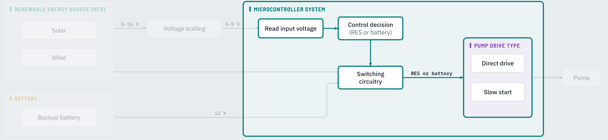
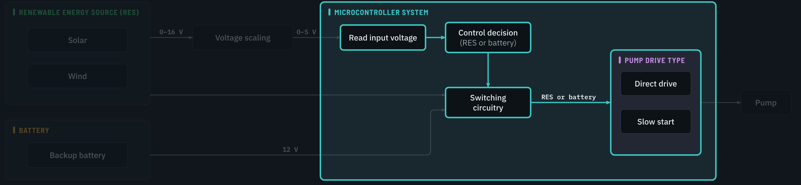

# Getting started with the Arduino

The **microcontroller system** in the [project overview](../project-overview.qmd)
is an Arduino Uno. It reads the scaled RES voltage, decides which supply to use,
drives the switching circuitry and starts the pump. This chapter is a quick
introduction to the board and to writing programs for it, so that the
following chapters can concentrate on the project.

```{=html}
<figure class="flow-diagram">
<figcaption>System overview · Microcontroller system</figcaption>
<a class="fd-light" href="images/system-microcontroller-light.png"></a>
<a class="fd-dark" href="images/system-microcontroller-dark.png"></a>
</figure>
```

## Learning outcomes

By the end of this chapter you should be able to:

- Describe the Arduino Uno R3 and the electrical limits of its pins
- Set up the Arduino IDE and explain the `setup()` / `loop()` structure of a sketch
- Drive a digital output and size a current-limiting resistor for an LED
- Choose suitable data types and use named constants, loops, arrays and functions
- Distinguish blocking (`delay`) from non-blocking (`millis`) timing

---

## 1. The microcontroller in a mechatronic system

A microcontroller (MCU) is the decision-making element of an embedded control
system. It samples sensors, executes a control law in firmware, and commands
actuators, usually through driver stages, because MCU pins can only supply a few
milliamps.

| Inputs (sensors) | Typical interface | Outputs (actuators/displays) | Typical interface |
|---|---|---|---|
| Temperature (thermistor, LM35) | Analogue voltage → ADC | LEDs | Digital output / PWM |
| Humidity (DHT22) | Single-wire digital | Stepper motors | Step/direction to a driver (A4988) |
| Light (LDR, photodiode) | Analogue via divider | DC motors | PWM to an H-bridge (L298N) |
| Infrared (PIR, IR receiver) | Digital | Servos | 50 Hz PWM pulse width |
| Distance (HC-SR04 ultrasonic) | Digital pulse timing | LCD displays | I²C or parallel |

The project uses three of these patterns: an analogue voltage through a divider
(the RES voltage on A0), digital outputs through driver transistors (the
switching circuitry), and PWM to an H-bridge motor driver (the pump drive).

---

## 2. Arduino Uno R3 hardware

The Uno R3 (the Elegoo board in the lab is a compatible clone) is built around
the **Microchip ATmega328P**:

| Parameter | Value |
|---|---|
| Core | 8-bit AVR RISC, 16 MHz (≈ 16 MIPS) |
| Flash (program) / SRAM (variables) / EEPROM | 32 KB (0.5 KB used by the bootloader) / **2 KB** / 1 KB |
| Digital I/O | 14 pins (D0–D13), 6 with PWM (`~` 3, 5, 6, 9, 10, 11) |
| Analogue inputs | 6 (A0–A5), 10-bit ADC (0–1023) |
| Logic level | 5 V |
| Pin current | **20 mA recommended, 40 mA absolute maximum** per pin; 200 mA total through VCC/GND |
| Supply input | USB 5 V, or 7–12 V on the barrel jack / Vin |
| Serial interfaces | UART (D0 RX / D1 TX, shared with USB), SPI (D10–D13 / ICSP), I²C (A4 SDA / A5 SCL) |


| Feature | Function |
|---|---|
| USB connector (with a USB–serial converter) | Powers the board, uploads firmware via the bootloader, carries `Serial` data |
| External power jack / Vin | 7–12 V input to the on-board **5 V linear regulator** (see [Voltage measurement](01-voltage-regulation.md)) |
| 3.3 V regulator | Low-current (≈ 50 mA) 3.3 V output for 3.3 V sensors |
| 16 MHz crystal | Clock source; sets timing accuracy for `millis()`, serial baud rates and PWM |
| Reset button / pin | Restarts the program from `setup()` |
| D0/D1 (RX/TX) | Used by `Serial` and for uploading; avoid using them as general I/O |

The 20 mA pin limit is the reason the project never powers anything heavier
than an LED straight from a pin: the supplies are switched through relays and
the pump through a motor driver.

---

## 3. Toolchain and program structure

1. Install the **Arduino IDE 2.x** from <https://www.arduino.cc/en/software>.
2. Select the board: **Tools › Board › Arduino AVR Boards › Arduino Uno**.
3. Select the serial port: **Tools › Port** (COMx on Windows, `/dev/ttyACM0` or
   `/dev/cu.usbmodem…` on Linux/macOS).

   

4. Start from **File › Examples › 01.Basics › BareMinimum**.

   

**Verify** compiles the sketch (C++ with the Arduino core library); **Upload**
compiles it and transfers the program to the board. Every Arduino sketch has the
same two functions:

```cpp
void setup() {
  // put your setup code here, to run once:

}

void loop() {
  // put your main code here, to run repeatedly:

}
```

- `setup()` runs **once**, when the board powers up or is reset. Use it to
  configure pins (`pinMode`) and start serial communication (`Serial.begin`).
- `loop()` then runs **over and over, forever**, until the power is removed.

There is no operating system: `loop()` is a **super-loop**, and anything that
blocks inside it (a long `delay()`, waiting on a sensor) stops every other task.
Section 8 returns to this point, and it matters for the project: the Arduino has
to keep watching the RES voltage while it ramps the pump up.

---

## 4. Prototyping on a breadboard

A solderless breadboard is a matrix of spring-contact clips:

- **Terminal strips:** each half-column of five holes (a–e, f–j) is one clip. The
  centre channel isolates the two halves, so a chip can straddle it.
- **Power rails:** continuous along the board's length (on some full-size boards
  they are split at the midpoint). Top and bottom rails are independent.


The clips are rated at roughly 1 A and add 10–50 mΩ per contact. That is fine
for LEDs and sensors but rules breadboards out for motor currents: put the
supply and pump connections on screw terminals or a soldered board.

> 🔧 **Try it:** [Breadboard continuity lab](applets/breadboard.html) — add wires and components, reveal the hidden strips, test continuity between any two holes, and check whether each component is placed correctly.

---

## 5. Digital output and LEDs

`pinMode(pin, OUTPUT)` makes a pin an output; `digitalWrite(pin, HIGH)` drives it
to ≈ 5 V and `LOW` to ≈ 0 V.

### LEDs need a series resistor

The **anode** (+, long leg) of an LED must be at the higher potential, the
**cathode** (−, short leg, flat edge on the lens) at the lower.


An LED is a diode: its current rises **exponentially** with voltage, so it
cannot set its own current. Connected straight to a supply, the current is
limited only by the supply's internal resistance and the LED burns out. A series
resistor sets the current. Above the knee of its curve the LED's voltage is
roughly its forward voltage $V_f$, so:

$$R = \frac{V_s - V_f}{I_F}$$

From a 5 V pin, a red LED ($V_f \approx 2$ V) at 15 mA needs
$R = (5 - 2)/0.015 = 200\ \Omega$ → use the next standard value up, **220 Ω**.
Always round **up**, and check the resistor's power, $P = I^2R$.

> ▶️ **[LED circuit explorer](applets/led-circuit.html)** — choose a supply and LED colour, slide through the standard resistor values and watch the current. Pick a resistor that is too small and the LED burns out.

**Try these:** (if the LED burns out, move the slider to a larger resistor
first, then press **Replace the LED**)

1. With the **9 V battery** and a **red LED**, find the smallest standard
   resistor that keeps the current at or below 20 mA.
2. Slide all the way to **no resistor**. What happens, and why?
3. Switch to a **blue LED**. Why does the smallest safe resistor change?
4. At the resistor you found in task 1, how much power does the resistor
   dissipate? Is a standard ¼ W resistor enough?

<details>
<summary>Answers</summary>

1. **390 Ω.** Exactly 20 mA needs $R = (9 - 2.0)/0.020 = 350\ \Omega$, which is not a standard value. The next E12 value up is 390 Ω, giving $(9 - 2.0)/390 = 17.9\ \text{mA}$.
2. With no resistor, only the battery's small internal resistance limits the current, so it tries to reach amps, far past the 30 mA maximum, and the LED burns out.
3. A blue LED has a higher forward voltage (3.2 V), so the resistor has less voltage across it: $(9 - 3.2)/0.020 = 290\ \Omega$, so the smallest safe standard value is **330 Ω**.
4. $P = V_R^2/R = 7^2/390 \approx 126\ \text{mW}$: about half of a ¼ W (250 mW) rating, which is acceptable.

</details>

### Example 1a — blink an LED

```cpp
/*
 * Example 1a: Blink an LED at 1 Hz (0.5 s on, 0.5 s off).
 * Hardware: red LED + 220 Ω resistor from D13 to GND.
 */

const uint8_t  kLedPin       = 13;    // the LED is wired to digital pin 13
const uint16_t kHalfPeriodMs = 500;   // on time = off time, in milliseconds

// setup() runs once, when the board powers up or is reset.
void setup() {
  pinMode(kLedPin, OUTPUT);           // pin 13 drives (outputs to) the LED
}

// loop() runs over and over, forever.
void loop() {
  digitalWrite(kLedPin, HIGH);        // 5 V on pin 13: LED on
  delay(kHalfPeriodMs);               // wait 500 ms
  digitalWrite(kLedPin, LOW);         // 0 V on pin 13: LED off
  delay(kHalfPeriodMs);               // wait 500 ms, then loop() starts again
}
```

- **`const`** means the value can never change while the program runs. If you
  accidentally write `kLedPin = 12;` later, the compiler stops with an error.
- **`uint8_t`** is a whole number that uses 1 byte and holds 0 to 255: plenty for
  a pin number. **`uint16_t`** uses 2 bytes, 0 to 65 535, enough for delays up to
  about 65 s.
- The **`k`** at the start of a name is a convention for *constant*: a fixed value
  set at the top of the file.

Pin 13 also drives the on-board "L" LED, which is a useful check before any
external wiring.

> ▶️ **[Run it: Example 1a in the code runner](applets/code-runner.html#ex1a)** — the active line is highlighted as the LED blinks.

---

## 6. Data types and named constants

On an 8-bit AVR, type sizes differ from a desktop PC, and with only 2 KB of SRAM
they matter:

| Type | Size | Range | Typical use |
|---|---|---|---|
| `bool` | 1 byte | `true` / `false` | Flags and states (e.g. `onBattery`) |
| `uint8_t` | 1 byte | 0–255 | Pin numbers, PWM duty, small counters |
| `int` / `int16_t` | **2 bytes** | −32 768 to 32 767 | General integers, `analogRead()` results |
| `uint16_t` | 2 bytes | 0–65 535 | Short delays in ms |
| `long` / `int32_t` | 4 bytes | ±2.1 × 10⁹ | Large counts and intermediate sums |
| `unsigned long` | 4 bytes | 0–4.29 × 10⁹ | **Timestamps from `millis()`** |
| `float` | 4 bytes | ~7 significant digits | Measured voltages, scaled values |

Good practice:

- Declare fixed values as **`const`**. This documents intent and makes a hardware
  change (e.g. moving an LED to another pin) a one-line edit.
- Use the smallest type that fits the range, and `unsigned long` for anything
  compared with `millis()`.
- Avoid the Arduino `String` class in long-running firmware: repeated
  concatenation fragments the 2 KB heap. Use string literals or the `F()` macro:
  `Serial.println(F("Source: RES"));`.

---

## 7. Loops, arrays and functions

### Example 1b — varying the on-time with a `for` loop

Repeating the same four lines for each delay is error-prone. Store the values in
an array and loop through it:

```cpp
/*
 * Example 1b: Blink an LED with on-times stepping from 0.1 s to 1 s.
 * Hardware: red LED + 220 Ω resistor from D13 to GND.
 */

const uint8_t  kLedPin      = 13;                          // LED pin
const uint16_t kOffMs       = 500;                         // off time after each blink (ms)
const uint16_t kOnTimesMs[] = {100, 250, 500, 750, 1000};  // on time for each blink (ms)

// Number of values in the array = total bytes / bytes per value = 5.
const size_t   kNumSteps    = sizeof(kOnTimesMs) / sizeof(kOnTimesMs[0]);

void setup() {
  pinMode(kLedPin, OUTPUT);
}

void loop() {
  // i takes the values 0, 1, 2, 3, 4: one pass for each value in the array.
  for (size_t i = 0; i < kNumSteps; ++i) {
    digitalWrite(kLedPin, HIGH);         // LED on
    delay(kOnTimesMs[i]);                // stay on for the i-th on time
    digitalWrite(kLedPin, LOW);          // LED off
    delay(kOffMs);
  }
}
```

- **`for (size_t i = 0; i < kNumSteps; ++i)`**: start `i` at 0, keep looping while
  `i < kNumSteps`, add 1 after each pass.
- **`sizeof`** gives a size in bytes, worked out by the compiler. The whole array
  is 5 × 2 = 10 bytes and one value is 2 bytes, so `kNumSteps` = 10 ÷ 2 = 5. Add a
  sixth on-time and the count updates by itself.

> ▶️ **[Run it: Example 1b in the code runner](applets/code-runner.html#ex1b)** — watch `i` step through the array and the on-time grow.

### Exercise 1c — three LEDs, with a struct, a table and a function

**Task:** blink a red LED 2 times, then a green LED 3 times, then a blue LED 4
times, each blink 0.5 s on and 0.5 s off, and repeat.

Written out with `digitalWrite()` and `delay()`, those nine blinks take 36 lines.
Three tools make it short and easy to change:

- a **`struct`** (`BlinkStep`) that bundles the two facts about each stage: which
  pin, and how many blinks;
- a **table** (`kSequence`) listing the stages in order;
- a **function** (`blink`) that blinks any LED any number of times.

```cpp
/*
 * Exercise 1c: red 2 times, green 3 times, blue 4 times, each blink
 * 0.5 s on and 0.5 s off, using a struct, a table and a function.
 * Hardware: each LED in series with a 220 Ω resistor to GND.
 */

const uint8_t  kRedPin       = 13;
const uint8_t  kGreenPin     = 12;
const uint8_t  kBluePin      = 11;
const uint16_t kHalfPeriodMs = 500;   // time on, and time off, for each blink (ms)

// Each BlinkStep describes one stage: which pin, and how many blinks.
struct BlinkStep {
  uint8_t pin;
  uint8_t count;
};

// The sequence as a table. To change the order, a pin or a count, edit this only.
const BlinkStep kSequence[] = {
  {kRedPin,   2},
  {kGreenPin, 3},
  {kBluePin,  4},
};

// Blink one LED 'count' times.
void blink(uint8_t pin, uint8_t count, uint16_t halfPeriodMs) {
  for (uint8_t i = 1; i <= count; ++i) {
    digitalWrite(pin, HIGH);
    delay(halfPeriodMs);
    digitalWrite(pin, LOW);
    delay(halfPeriodMs);
  }
}

void setup() {
  for (const BlinkStep& step : kSequence) {   // every row of the table
    pinMode(step.pin, OUTPUT);
    digitalWrite(step.pin, LOW);              // start with the LED off
  }
}

void loop() {
  for (const BlinkStep& step : kSequence) {
    blink(step.pin, step.count, kHalfPeriodMs);
  }
}
```

| Pass | `step` is | `step.pin` | `step.count` | Call made |
|---|---|---|---|---|
| 1 | row 0 | 13 | 2 | `blink(13, 2, 500)`: red blinks twice |
| 2 | row 1 | 12 | 3 | `blink(12, 3, 500)`: green blinks 3 times |
| 3 | row 2 | 11 | 4 | `blink(11, 4, 500)`: blue blinks 4 times |

- Read the `for` line as "for each row in `kSequence`, call it `step`". The `&`
  means `step` looks at the row in the table instead of copying it; `const` means
  the loop can read the table but not change it.
- To make green blink 5 times, change one number in the table. To add a fourth
  LED, add one row. `blink()` and `loop()` don't change.

The project code uses the same habits: named constants for every pin and
threshold, and small functions such as `useBattery()` and `startRamp()` so that
`loop()` reads like the specification.

> ▶️ **[Run it: Exercise 1c in the code runner](applets/code-runner.html#ex1c2)** — press **Step** repeatedly: the Variables panel shows `step.pin` and `step.count` change as each row of the table is read.

---

## 8. Blocking vs non-blocking timing

`delay()` halts the CPU. During the Exercise 1c sequence (9 blinks, about 9 s)
the Arduino can do nothing else. That is unacceptable once it also has to
monitor the RES voltage and react to it. The standard alternative is to compare
elapsed time from `millis()` (milliseconds since reset) and act only when an
interval has passed:

```cpp
/*
 * Non-blocking blink: the LED toggles every 500 ms while loop() stays free
 * to run other tasks (e.g. reading the RES voltage) on every pass.
 */

const uint8_t       kLedPin     = 13;
const unsigned long kIntervalMs = 500;   // time between LED changes (ms)

unsigned long lastToggleMs = 0;          // millis() time of the last LED change
bool          ledOn        = false;      // remembers whether the LED is on

void setup() {
  pinMode(kLedPin, OUTPUT);
}

void loop() {
  const unsigned long now = millis();    // ms since the board started
  if (now - lastToggleMs >= kIntervalMs) {   // subtraction form is overflow-safe
    lastToggleMs = now;
    ledOn = !ledOn;                      // flip the state
    digitalWrite(kLedPin, ledOn ? HIGH : LOW);
  }

  // Other tasks run here every pass, e.g. checking the RES voltage.
}
```

- `ledOn ? HIGH : LOW` is the *ternary* operator: a one-line `if ... else`.
- `millis()` wraps around after about 49.7 days. Writing the test as
  `now - lastToggleMs >= interval` with `unsigned long` arithmetic stays correct
  across the wrap.

The pump's slow start in [Pump drive type](05-pump-drive-type.md) uses exactly
this pattern, so the Arduino keeps checking the RES while the pump speeds up.

> ▶️ **[Run it: the non-blocking blink in the code runner](applets/code-runner.html#millis)** — see `loop()` pass many times between LED toggles while `millis()` advances.

---

## Key points

- ATmega328P pins: 5 V logic, 20 mA recommended per pin, 200 mA total. Use driver
  stages (transistors, an H-bridge) for anything larger.
- Every sketch has `setup()` (runs once) and `loop()` (runs forever).
- An LED's current must be set by a series resistor: $R = (V_s - V_f)/I_F$, rounded
  **up** to a standard value.
- With 2 KB of SRAM, choose types deliberately and use `const` for fixed values.
- Named constants, tables and functions make hardware changes one-line edits.
- `delay()` blocks the super-loop. Use `millis()` timing whenever the Arduino must
  do more than one thing at once.
