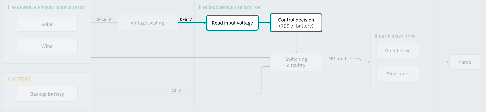
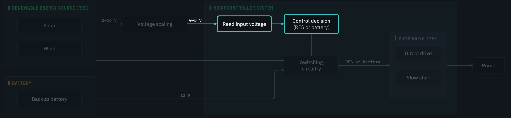

# Read input voltage

Inside the microcontroller system in the
[project overview](../project-overview.qmd), the first step is **read input
voltage**: `analogRead` turns the scaled voltage on an analogue pin into a whole
number from 0 to 1023. The second step is the **control decision**: is that
number high enough to run the pump from the RES, or should the system switch to
the battery?

The Arduino never needs to know the voltage in volts to make that decision. It
only needs to know whether the reading is above or below a switch-over point,
and that comparison works perfectly with whole numbers. This chapter starts with
a `float` to show what the numbers mean, then does everything with whole
numbers, which is the better way to program a small microcontroller. A
potentiometer on the bench stands in for the RES.

```{=html}
<figure class="flow-diagram">
<figcaption>System overview · Read input voltage</figcaption>
<a class="fd-light" href="images/system-read-input-light.png"></a>
<a class="fd-dark" href="images/system-read-input-dark.png"></a>
</figure>
```

## Learning outcomes

By the end of this chapter you should be able to:

- Read an analogue voltage with `analogRead`, and explain what the readings 0–1023
  mean in volts
- Explain why whole numbers are better than `float` on an Arduino
- Turn a voltage threshold into an `analogRead` value once, when the sketch compiles
- Make decisions with `if`, `else if` and `else` on whole-number readings
- Choose the RES switch-over point as a reading, and add hysteresis so the supply
  doesn't chatter

---

## 1. `analogRead`: what the numbers mean

The analogue pins (A0–A5) contain a **10-bit analogue-to-digital converter
(ADC)**: $2^{10} = 1024$ levels. `analogRead(pin)` returns a whole number from 0
to 1023:

| Voltage on pin | `analogRead()` returns |
|---|---|
| 0 V | 0 |
| 1 V | 205 |
| 2.5 V | ≈ 512 |
| 5 V | 1023 |

Each step is about $5/1023 \approx 4.9$ mV. That is why [Voltage
measurement](01-voltage-regulation.md) scales the RES maximum to just under 5 V:
the whole range of 1024 steps is used.

To turn a reading into volts, so that **a person** can see what it means:

$$V = \frac{5}{1023}\times\text{reading}$$

That needs a `float` (a number with a decimal point). Section 3 shows it once, and
then shows why the Arduino itself is better off without it.

---

## 2. The bench setup: a potentiometer

A **potentiometer** across 5 V gives a voltage from 0 to 5 V that you can change
by hand: a safe stand-in for the RES while you write and test the code. (See
[Voltage measurement](01-voltage-regulation.md#potentiometers-an-adjustable-divider)
for how it works.)


All the exercises use the same connection: the pot's outer pins to **5 V** and
**GND**, its wiper to **A1**. Each LED goes from an Arduino output pin, through a
220 Ω resistor and the LED, to ground.


| Exercise | Task | LEDs (each through 220 Ω to GND) |
|---|---|---|
| **7.1** | Read the pot voltage and print it | none |
| **7.2** | Use the pot as a dimmer for a red LED | red on **D10** (a PWM pin) |
| **7.3** | Blue LED on above 2.5 V, off below | blue on **D13** |
| **7.4** | Red for 0–2 V, green for > 2–3.5 V, blue for > 3.5–5 V | red **D11**, green **D12**, blue **D13** |

> 🔧 **Try it:** [Potentiometer applet](applets/potentiometer.html) — turn the knob and switch between Exercises 7.1 to 7.4.

---

## 3. Exercise 7.1 — read the pot voltage

### With a `float`: seeing what the numbers mean

```cpp
/*
 * Exercise 7.1: Read the potentiometer voltage and print it in volts.
 * Hardware: pot outer pins to 5 V and GND, wiper to A1.
 */

const uint8_t  kPotPin   = A1;       // pot wiper
const float    kAdcVref  = 5.0;      // analogRead reference voltage (V)
const float    kAdcMax   = 1023.0;   // largest analogRead value
const uint16_t kSampleMs = 500;      // time between readings (ms)

void setup() {
  Serial.begin(9600);                // start the Serial Monitor link
  // Analogue pins are inputs by default, so no pinMode() is needed.
}

void loop() {
  int   reading = analogRead(kPotPin);             // 0 to 1023
  float volts   = reading * (kAdcVref / kAdcMax);  // e.g. 512 -> 2.50
  Serial.print(reading);
  Serial.print(" = ");
  Serial.print(volts);
  Serial.println(" V");
  delay(kSampleMs);
}
```

Open **Tools › Serial Monitor** and turn the knob: each line shows the raw reading
and the voltage it stands for, e.g. `512 = 2.50 V`. Write the constants as `5.0`
and `1023.0`, with decimal points: `5/1023` in whole numbers is **0**.

> ▶️ **[Run it: Exercise 7.1 in the code runner](applets/code-runner.html#ex2d)** — turn the simulated pot and watch the reading and the voltage change together.

### Without a `float`: the better way

The same readout works in whole numbers if the voltage is in **millivolts**:
2502 mV is 2.502 V, and it's still a whole number.

```cpp
/*
 * Exercise 7.1, integer version: read the pot voltage with no float.
 * Hardware: pot outer pins to 5 V and GND, wiper to A1.
 */

const uint8_t  kPotPin    = A1;     // pot wiper
const long     kAdcVrefMv = 5000;   // analogRead reference voltage, in millivolts
const int      kAdcMax    = 1023;   // largest analogRead value
const uint16_t kSampleMs  = 500;    // time between readings (ms)

// Read an analogue pin and return the voltage on it in millivolts (0 to 5000).
int readMillivolts(uint8_t pin) {
  int reading = analogRead(pin);                 // 0 to 1023
  return reading * kAdcVrefMv / kAdcMax;         // whole-number maths, e.g. 512 -> 2502
}

void setup() {
  Serial.begin(9600);
}

void loop() {
  int mv = readMillivolts(kPotPin);    // wiper voltage in mV
  Serial.print(mv);
  Serial.println(" mV");               // e.g. "2502 mV" means 2.502 V
  delay(kSampleMs);
}
```

- **`kAdcVrefMv` is a `long`** so that `reading × 5000` (up to about 5.1 million) is
  worked out in 4-byte `long` maths; it would overflow a 2-byte `int` (maximum
  32 767). The answer, 0 to 5000, fits back in an `int`.
- **Multiply first, then divide.** `reading / 1023 * 5000` would throw the fraction
  away straight away and give only 0 or 5000.

---

## 4. Why whole numbers are better

**Memory.** The ATmega328P has no hardware for decimal (floating-point) maths. As
soon as a sketch uses a `float` (multiplying, dividing, comparing or printing
one), the compiler adds a library of software routines to program memory. These
are the real sizes from compiling the exercises for the Uno:

| Exercise | Flash used, `float` | Flash used, integer | Saved |
|---|---|---|---|
| 7.1 | 3 780 bytes | 2 690 bytes | **1 090 bytes** (29%) |
| 7.3 | 3 890 bytes | 2 648 bytes | **1 242 bytes** (32%) |
| 7.4 | 3 982 bytes | 2 726 bytes | **1 256 bytes** (32%) |

A `float` variable also takes **4 bytes** of RAM, where an `int` takes **2**, on a
chip with only 2 KB of RAM.

**Speed.** Each `float` sum runs as a block of software, many times slower than a
whole-number sum, which is a single instruction or two.

**Exactness.** Whole numbers are exact. Many decimals can't be stored exactly in a
`float` (0.2 is stored as 0.200000003…), so small errors can build up and a
comparison can land on the wrong side of a threshold.

**The decision doesn't need volts.** `reading > 511` is exactly the same test as
`volts > 2.5`. So instead of converting **every reading** into volts, convert the
**threshold** into a reading once:

$$\text{reading} = \frac{\text{millivolts} \times 1023}{5000}$$

| Threshold | Volts | Millivolts | As an `analogRead` value |
|---|---|---|---|
| Exercise 7.3 switching point | 2.5 V | 2500 | 511 |
| Exercise 7.4, top of the red band | 2.0 V | 2000 | 409 |
| Exercise 7.4, top of the green band | 3.5 V | 3500 | 716 |

Written in the code as `const int kThreshold = 2500L * 1023 / 5000;`, the sum uses
only constants, so the **compiler** works it out (511) when you press Verify. The
Arduino never does it. The `L` makes 2500 a `long`, because 2500 × 1023 (about
2.6 million) is too big for an `int`.

> ✅ **Rule of thumb:** make decisions on whole numbers (`analogRead` values or
> millivolts). Use a `float` only when you really need a fraction, and convert to
> volts only when a person has to read the value.

---

## 5. Exercise 7.2 — dimmer switch

```cpp
/*
 * Exercise 7.2: Use the potentiometer as a dimmer for a red LED.
 * Hardware: pot wiper to A1; red LED + 220 Ω resistor on D10 (a PWM pin).
 */

const uint8_t kPotPin = A1;     // pot wiper
const uint8_t kRedPin = 10;     // must be a PWM (~) pin

void setup() {
  pinMode(kRedPin, OUTPUT);
}

void loop() {
  int reading    = analogRead(kPotPin);                // 0 to 1023
  int brightness = map(reading, 0, 1023, 0, 255);      // rescale to 0 to 255
  analogWrite(kRedPin, brightness);                    // set the LED brightness
}
```

- `analogRead` gives **0–1023** (10 bits), but `analogWrite` takes **0–255**
  (8 bits). `analogWrite` sets an average output voltage by switching the pin on
  and off quickly (PWM); [Pump drive type](05-pump-drive-type.md) explains it in
  full, because it is how the pump is ramped up.
- **`map(value, fromLow, fromHigh, toLow, toHigh)`** rescales a number from one
  range to another, entirely in whole numbers: 0 → 0, 1023 → 255, 512 → 127. No
  `float` needed.
- There is **no `delay()`**, so the brightness follows the knob immediately.

> ▶️ **[Run it: Exercise 7.2 in the code runner](applets/code-runner.html#ex2d1)** — turn the simulated pot and watch `map()` set the LED brightness.

---

## 6. Exercise 7.3 — switch at 2.5 V

```cpp
/*
 * Exercise 7.3: Blue LED on above 2.5 V, off at or below 2.5 V, with no float.
 * Hardware: pot wiper to A1; blue LED + 220 Ω resistor on D13.
 */

const uint8_t  kPotPin   = A1;       // pot wiper
const uint8_t  kBluePin  = 13;       // blue LED
const uint16_t kSampleMs = 500;

// 2.5 V as an analogRead value: 2500 mV x 1023 / 5000 mV = 511.
// Only constants, so the compiler works this out once; the Arduino never does.
const int kThreshold = 2500L * 1023 / 5000;

void setup() {
  Serial.begin(9600);
  pinMode(kBluePin, OUTPUT);
}

void loop() {
  int reading = analogRead(kPotPin);  // 0 to 1023, no conversion
  Serial.println(reading);

  if (reading > kThreshold) {
    digitalWrite(kBluePin, HIGH);     // above 2.5 V: LED on
  } else {
    digitalWrite(kBluePin, LOW);      // 2.5 V or below: LED off
  }
  delay(kSampleMs);
}
```

- **`if (reading > kThreshold)`** tests a condition. If it is true, the first block
  runs; otherwise the `else` block runs. Exactly one of the two always runs.
- **`kThreshold`** is a named constant, so changing the switching point means
  editing one number, written in millivolts so it is easy to read.
- **Common mistake:** writing the test the wrong way round (`reading < kThreshold`
  → HIGH) lights the LED *below* 2.5 V instead of above it.

This **threshold** is exactly what the project uses for its control decision:
replace the blue LED with "use the RES".

> ▶️ **[Run it: Exercise 7.3 in the code runner](applets/code-runner.html#ex2d2int)** — move the pot either side of 2.5 V: the raw `reading` is compared with 511, and exactly one branch of the `if ... else` runs.

---

## 7. Exercise 7.4 — three voltage bands

```cpp
/*
 * Exercise 7.4: Show which voltage band the pot is in, with no float.
 *   0 to 2 V     -> red LED
 *   >2 to 3.5 V  -> green LED
 *   >3.5 to 5 V  -> blue LED
 * Hardware: pot wiper to A1; LEDs + 220 Ω resistors on D11, D12, D13.
 */

const uint8_t  kPotPin   = A1;
const uint8_t  kRedPin   = 11;
const uint8_t  kGreenPin = 12;
const uint8_t  kBluePin  = 13;
const uint16_t kSampleMs = 500;

// Thresholds as analogRead values, worked out by the compiler.
const int kLowMax = 2000L * 1023 / 5000;    // 2.0 V -> 409
const int kMidMax = 3500L * 1023 / 5000;    // 3.5 V -> 716

// Turn each LED on (true) or off (false) in one call.
void setLeds(bool red, bool green, bool blue) {
  digitalWrite(kRedPin,   red   ? HIGH : LOW);
  digitalWrite(kGreenPin, green ? HIGH : LOW);
  digitalWrite(kBluePin,  blue  ? HIGH : LOW);
}

void setup() {
  Serial.begin(9600);
  pinMode(kRedPin, OUTPUT);
  pinMode(kGreenPin, OUTPUT);
  pinMode(kBluePin, OUTPUT);
}

void loop() {
  int reading = analogRead(kPotPin);    // 0 to 1023: a whole number, no conversion
  Serial.println(reading);

  if (reading <= kLowMax) {
    setLeds(true, false, false);        // 0 to 2 V: red only
  } else if (reading <= kMidMax) {
    setLeds(false, true, false);        // above 2 V, up to 3.5 V: green only
  } else {
    setLeds(false, false, true);        // above 3.5 V: blue only
  }

  delay(kSampleMs);
}
```

- **`if ... else if ... else`** checks the conditions in order and runs **only the
  first one that is true**. By the time the `else if` is tested, we already know
  the reading is above 409, so there is no need to test that again.
- Because only one branch runs, exactly one LED is ever lit.
- **`Serial.println(reading)`** prints the raw 0–1023 value. Printing
  `reading * 5.0 / 1023` instead would bring back the whole `float` library, even
  if nothing else used one.

| Operator | Meaning |
|---|---|
| `<`, `<=`, `>`, `>=` | less than, less or equal, greater, greater or equal |
| `==` | equal to (two `=`!) |
| `&&` | AND — both conditions true |
| `\|\|` | OR — either condition true |

> ▶️ **[Run it: Exercise 7.4 in the code runner](applets/code-runner.html#ex2eint)** — move the pot through the three bands; the Variables panel shows the raw `reading` being compared with 409 and 716. Compare it with [the `float` version](applets/code-runner.html#ex2e).

---

## 8. The control decision: RES or battery

The decision is Exercise 7.3 with the LED replaced by the supply: if the reading
is high enough, use the RES; otherwise use the battery. The functions `useRes()`
and `useBattery()` switch the supplies; [Switching
circuitry](04-switching-circuitry.md) writes them for the relay module.

```cpp
if (reading < kSwitchReading) {
  useBattery();                // RES voltage has dropped
} else {
  useRes();                    // RES is fine
}
```

The only question is what number `kSwitchReading` should be. There are two ways
to find it, and neither needs a `float` in the sketch.

### Choosing the switch-over voltage

Start from the **minimum RES voltage the pump needs** to run properly, say 8 V.
Setting the switch-over point too close to the RES maximum (for example 4.8 V at
the pin, when 5 V is the maximum) means the RES is used only when it is within
about 4 % of its peak, which wastes most of the renewable energy.

### Calculate the reading at compile time

The divider scales the RES voltage by $R_2/(R_1+R_2)$, and the ADC turns the pin
voltage into a reading. Put both steps into one constant, in millivolts and ohms,
and the compiler does the sum:

```cpp
const long kR1 = 22000;             // divider, top resistor (ohms)
const long kR2 = 10000;             // divider, bottom resistor (ohms)
const long kSwitchMv = 8000;        // switch to the battery below 8 V at the RES

// 8000 mV x 10k / 32k = 2500 mV at the pin -> 2500 x 1023 / 5000 = 511
const int kSwitchReading = kSwitchMv * kR2 / (kR1 + kR2) * 1023 / 5000;
```

Every value is a `long`, so the intermediate sums (up to about 80 million) fit,
and the result, 511, fits in an `int`. The sketch then compares each reading with
511: no division, no `float`, while it runs.

### Or measure the reading

Resistor tolerances, or an adjustable divider ([Voltage
measurement](01-voltage-regulation.md#setting-an-adjustable-divider-safely)),
mean the real divider can differ from the calculation. Measuring avoids the
maths altogether:

1. Set a bench supply to the switch-over voltage, e.g. 8.0 V, and connect it where
   the RES goes.
2. Upload a sketch that prints `analogRead(A0)` to the Serial Monitor, as in
   Exercise 7.1.
3. Note the number, e.g. 508, and use it: `const int kSwitchReading = 508;`.

If the divider uses a trimmer, measure again whenever it is moved.

### Hysteresis: stop the chatter

If the RES voltage hovers right at the switch-over point (a gusty wind turbine, a
cloud passing the panel), a single threshold flips the supply back and forth on
every reading. Relays wear out, and the pump is repeatedly hit with a new supply.
Use two thresholds:

```cpp
const int kToBattery = 2300L * 1023 / 5000;   // 2.3 V at the pin -> 470
const int kToRes     = 2700L * 1023 / 5000;   // 2.7 V at the pin -> 552

void loop() {
  int reading = analogRead(kResPin);

  if (reading < kToBattery) {
    useBattery();                // clearly too low
  } else if (reading > kToRes) {
    useRes();                    // clearly recovered
  }
  // Between 470 and 552 neither branch runs, so the supply stays as it is.

  delay(kSampleMs);
}
```

- With one threshold, a reading that wobbles 510 → 512 → 510 switches every time.
- With two thresholds there is a **dead band** from 470 to 552. Inside it, nothing
  changes, so the pump stays on whichever supply it already had.
- This is the same idea as a home thermostat, which doesn't switch the heating on
  and off at exactly one temperature.

> 🔧 **Try it:** [RES battery-backup simulator](applets/res-backup.html) — tick "Gusty", put the wind around the threshold and watch the supply switch; then think about how hysteresis would help.

---

## Key points

- `analogRead` returns a whole number, 0–1023, for 0–5 V: about 4.9 mV per step.
  Converting to volts (`reading * 5.0 / 1023.0`) is useful for **understanding**
  the numbers, or for showing them to a person.
- On an Arduino, **avoid `float`** for decisions: it adds over 1 KB of program
  memory, runs much more slowly, and isn't exact. Whole numbers are smaller,
  faster and exact.
- Convert each **threshold** into a reading once, with constants the compiler works
  out (`2500L * 1023 / 5000`), instead of converting every reading into volts.
- The RES switch-over point is just a reading: calculate it at compile time from
  the divider, or measure it with a bench supply.
- `if / else if / else` turns a reading into decisions; add **hysteresis** so the
  supply doesn't chatter.
