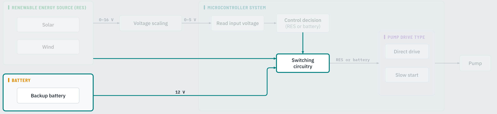
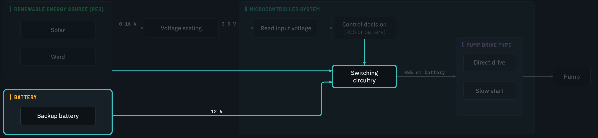

# Switching circuitry

Once the Arduino has decided between the RES and the battery, the **switching
circuitry** in the [project overview](../project-overview.qmd) connects the
chosen supply to the pump. An Arduino pin can supply only about 20 mA at 5 V; a
pump needs amps at 12 V or more. The switching circuitry lets the small signal
control the large current.

This chapter does it with a **relay module**: first driving the relays from the
Arduino, then building the complete RES / battery switch-over on a breadboard.

```{=html}
<figure class="flow-diagram">
<figcaption>System overview · Switching circuitry</figcaption>
<a class="fd-light" href="images/system-switching-light.png"></a>
<a class="fd-dark" href="images/system-switching-dark.png"></a>
</figure>
```

## Learning outcomes

By the end of this chapter you should be able to:

- Explain how a relay module works and wire a load through it
- Drive relays from the Arduino, including active-LOW modules
- Build and program the RES / battery switch-over with relays

---

## 1. What the switching circuitry must do

- **Connect one supply to the pump.** The pump's positive supply comes from either
  the RES or the battery.
- **Never connect the two supplies together.** If the RES and the battery were
  joined directly, current would flow from the higher one into the lower one,
  limited only by wiring resistance.
- **Isolate the Arduino from the power circuit.** The Arduino provides a
  logic-level signal and nothing more.

---

## 2. The relay module


A **5 V dual relay module** has two independent relays on one board, each
controlled by an Arduino digital pin. It contains **opto-isolators**: the
Arduino's signal drives an LED inside the opto-isolator, which switches the relay
driver. The Arduino is therefore *optically* (not electrically) connected to the
relay coil, which protects it from the coil's voltage spikes.

### Control side vs operating side


| Side | Pins | Connects to |
|---|---|---|
| **Control (low-voltage) side** | `VCC`, `GND`, `IN1`, `IN2` | Arduino 5 V, GND and two digital pins |
| **Operating (switched) side** | Screw terminals for each relay: `NC`, `COM`, `NO` | The power circuit being switched (RES, battery, pump) |

The relay contacts on these modules are rated up to **10 A at 250 VAC / 30 VDC**,
far beyond anything an Arduino pin could switch directly.


The jumper between **JD-VCC** and **VCC** lets the relay coils share the
Arduino's 5 V supply; leave it in place.

### The relay mechanism

Inside each relay is an **electromagnet (coil)** and a **switch arm**:

| Terminal | Meaning |
|---|---|
| **COM** | Common — the moving contact; wire your power source here |
| **NC** | Normally Closed — connected to COM when the relay is **off** (coil not energised) |
| **NO** | Normally Open — connected to COM only when the relay is **on** (coil energised) |

| Relay off (de-energised): COM → NC | Relay on (energised): COM → NO |
|---|---|
|  |  |

When the coil is energised, its magnetic field pulls the arm from NC across to
NO: you hear a **click** and the module's indicator LED lights.

### Switching a load

To switch a lamp (or pump, or LED) from a battery:

- Battery **+ve → COM**
- **NO → load → ground** (battery −ve)

The lamp then lights only when the relay is energised. Wire to **NC** instead if
you want the load on by default and switched *off* by the Arduino.

| | |
|---|---|
|  |  |

> ⚠️ **Active-LOW inputs.** On most of these blue opto-isolated modules a **LOW**
> on `IN1`/`IN2` turns the relay **ON**, and HIGH turns it off. Test yours: upload
> Example 3a and watch which state lights the module LED.

> 🔧 **Try it:** [Relay simulator](applets/relay.html) — switch between active-LOW and active-HIGH and between NO/NC wiring.

---

## 3. Driving the relays from the Arduino

### Example 3a — open and close relay 1


| Arduino | Relay module |
|---|---|
| 5 V | VCC |
| GND | GND |
| Pin 13 | IN1 |

> ⚠️ The diagram above labels the supply wire "3.5V to vcc". The Arduino has no
> 3.5 V pin, and the relay coils are rated at 5 V: connect **VCC to the 5 V pin**.

```cpp
/*
 * Example 3a: Switch relay 1 on and off every second.
 * Hardware: Arduino 5 V -> VCC, GND -> GND, D13 -> IN1 on the relay module.
 */

const uint8_t  kRelay1Pin = 13;      // Arduino pin 13 drives IN1
const uint16_t kSwitchMs  = 1000;    // time in each state (ms)

// The relay module is active-LOW: LOW switches a relay on, HIGH switches it off.
const uint8_t  kRelayOn   = LOW;
const uint8_t  kRelayOff  = HIGH;

void setup() {
  digitalWrite(kRelay1Pin, kRelayOff);   // choose "off" before the pin becomes an output
  pinMode(kRelay1Pin, OUTPUT);
}

void loop() {
  digitalWrite(kRelay1Pin, kRelayOn);    // relay energised: COM connects to NO (click)
  delay(kSwitchMs);
  digitalWrite(kRelay1Pin, kRelayOff);   // relay released: COM back to NC (click)
  delay(kSwitchMs);
}
```

- **`kRelayOn = LOW` and `kRelayOff = HIGH`** give names to the module's
  back-to-front logic. If you swap to an active-HIGH module you only change these
  two lines.
- **`digitalWrite` before `pinMode`**: at start-up the pins are inputs. Writing
  `HIGH` first and *then* making the pin an output means it goes straight to
  "off". The other way round briefly outputs `LOW`, which would click the relay on
  for an instant at every reset.

> ▶️ **[Run it: Example 3a in the code runner](applets/code-runner.html#ex3a)** — watch `kRelayOn` (LOW) switch the relay on.

### Exercise 3b — alternate relay 1 and relay 2


Add **pin 12 → IN2**.

```cpp
/*
 * Exercise 3b: Alternate between relay 1 and relay 2.
 * Hardware: D13 -> IN1, D12 -> IN2, 5 V -> VCC, GND -> GND.
 */

const uint8_t  kRelay1Pin = 13;      // drives IN1
const uint8_t  kRelay2Pin = 12;      // drives IN2
const uint16_t kRelay1Ms  = 500;     // time with relay 1 on (ms)
const uint16_t kRelay2Ms  = 1000;    // time with relay 2 on (ms)
const uint8_t  kRelayOn   = LOW;     // active-LOW module
const uint8_t  kRelayOff  = HIGH;

void setup() {
  digitalWrite(kRelay1Pin, kRelayOff);   // both relays off at start-up
  digitalWrite(kRelay2Pin, kRelayOff);
  pinMode(kRelay1Pin, OUTPUT);
  pinMode(kRelay2Pin, OUTPUT);
}

void loop() {
  digitalWrite(kRelay2Pin, kRelayOff);   // relay 2 off first ...
  digitalWrite(kRelay1Pin, kRelayOn);    // ... then relay 1 on
  delay(kRelay1Ms);

  digitalWrite(kRelay1Pin, kRelayOff);   // relay 1 off first ...
  digitalWrite(kRelay2Pin, kRelayOn);    // ... then relay 2 on
  delay(kRelay2Ms);
}
```

**Off before on (break before make):** each change switches the old relay off
before switching the new one on. With LEDs it makes no difference, but when the
relays switch the RES and the battery, it stops the two supplies ever being
connected together, even for a moment.

> ▶️ **[Run it: Exercise 3b in the code runner](applets/code-runner.html#ex3b)** — see each relay switched off before the other comes on.

### Exercises 3c and 3d — switch LEDs through the relays


- A separate **battery** powers an LED circuit; its +ve goes to **COM** of relay 1,
  and **NO** → resistor → blue LED → battery −ve. The Example 3a code now switches
  the LED, but the LED's power comes from the battery, not the Arduino.
- Wire a green LED through relay 2 the same way and run the Exercise 3b code: the
  LEDs alternate as the relays alternate.


### Exercise 3e — potentiometer control


This combines [Read input voltage](03-read-input-voltage.md) with the relays: the
pot chooses which relay is on.

```cpp
/*
 * Exercise 3e: The potentiometer chooses which relay is on.
 * Below 2.5 V: relay 2 on (green LED). At or above 2.5 V: relay 1 on (blue LED).
 * Hardware: pot wiper -> A1; D13 -> IN1 (blue LED circuit);
 *           D12 -> IN2 (green LED circuit); 5 V -> VCC, GND -> GND.
 */

const uint8_t  kPotPin     = A1;
const uint8_t  kBlueRelay  = 13;      // IN1: switches the blue LED
const uint8_t  kGreenRelay = 12;      // IN2: switches the green LED
const float    kThreshold  = 2.5;     // switching voltage (V)
const float    kAdcVref    = 5.0;
const float    kAdcMax     = 1023.0;
const uint16_t kSampleMs   = 100;
const uint8_t  kRelayOn    = LOW;     // active-LOW module
const uint8_t  kRelayOff   = HIGH;

float readVolts(uint8_t pin) {
  return analogRead(pin) * (kAdcVref / kAdcMax);
}

// Switch a relay on (true) or off (false), hiding the active-LOW detail.
void setRelay(uint8_t pin, bool on) {
  digitalWrite(pin, on ? kRelayOn : kRelayOff);
}

void setup() {
  Serial.begin(9600);
  digitalWrite(kBlueRelay, kRelayOff);    // both off at start-up
  digitalWrite(kGreenRelay, kRelayOff);
  pinMode(kBlueRelay, OUTPUT);
  pinMode(kGreenRelay, OUTPUT);
}

void loop() {
  float vOut = readVolts(kPotPin);
  Serial.println(vOut);

  if (vOut < kThreshold) {
    setRelay(kBlueRelay, false);          // off first ...
    setRelay(kGreenRelay, true);          // ... then on: green LED lit
  } else {
    setRelay(kGreenRelay, false);
    setRelay(kBlueRelay, true);           // blue LED lit
  }

  delay(kSampleMs);
}
```

Replace the pot with the divider from the RES and the LEDs with the RES and
battery supplies, and you have the switch-over system.

> ▶️ **[Run it: Exercise 3e in the code runner](applets/code-runner.html#ex3e)** — move the pot either side of 2.5 V and follow `setRelay()`.

---

## 4. The switch-over with relays

The breadboard prototype builds the whole system with the relay module. A
resistor and LED stand in for the pump.

### Building it


1. **Power and signals from the Arduino to the relay module:** 5 V → VCC,
   GND → GND, pin 13 → IN1 (**battery** relay), pin 12 → IN2 (**RES** relay).
2. **RES power in through its relay:** RES +ve → COM of the RES relay; its **NO**
   → the breadboard rail that feeds the load; RES −ve → the ground rail.

   

3. **Battery power in through its relay:** battery +ve → COM of the battery
   relay; its **NO** joins the same load rail; battery −ve → the ground rail.

   

4. **The monitoring system:** the voltage divider across the RES, with its
   mid-point to an analogue input (see [Voltage
   regulation](01-voltage-regulation.md)).

   

5. **All the grounds connected together:** RES −ve, battery −ve, Arduino GND and
   the load's −ve on one rail. Without a shared ground, `analogRead` has no
   reference.

   

| Connection | From | To |
|---|---|---|
| Relay power | Arduino 5 V | Relay VCC |
| Relay ground | Arduino GND | Relay GND |
| Battery relay control | Arduino pin 13 | IN1 |
| RES relay control | Arduino pin 12 | IN2 |
| RES supply | RES +ve | COM, RES relay |
| Battery supply | Battery +ve | COM, battery relay |
| Load supply | NO of both relays | Load (+) |
| Common ground | RES −ve, battery −ve, Arduino GND, load (−) | Breadboard ground rail |
| Monitoring | RES +ve → R₁ → (A0) → R₂ → ground | Arduino A0 |

### The code

```cpp
/*
 * Run the load from the renewable energy source (RES) while its voltage is
 * high enough, and switch to the battery when it drops.
 * Hardware: divider mid-point -> A0; D12 -> IN2 (RES relay);
 *           D13 -> IN1 (battery relay); 5 V -> VCC; all grounds joined.
 */

const uint8_t  kResPin     = A0;       // divider mid-point
const uint8_t  kResRelay   = 12;       // IN2: connects the RES to the load
const uint8_t  kBatRelay   = 13;       // IN1: connects the battery to the load
const float    kThresholdV = 2.5;      // below this (at the pin) the RES is too low
const float    kAdcVref    = 5.0;
const float    kAdcMax     = 1023.0;
const uint16_t kSampleMs   = 100;
const uint8_t  kRelayOn    = LOW;      // the relay module is active-LOW
const uint8_t  kRelayOff   = HIGH;

float readVolts(uint8_t pin) {
  return analogRead(pin) * (kAdcVref / kAdcMax);
}

// Power the load from the RES. The battery is disconnected first.
void useRes() {
  digitalWrite(kBatRelay, kRelayOff);
  digitalWrite(kResRelay, kRelayOn);
}

// Power the load from the battery. The RES is disconnected first.
void useBattery() {
  digitalWrite(kResRelay, kRelayOff);
  digitalWrite(kBatRelay, kRelayOn);
}

void setup() {
  Serial.begin(9600);
  digitalWrite(kResRelay, kRelayOff);    // both relays off until we decide
  digitalWrite(kBatRelay, kRelayOff);
  pinMode(kResRelay, OUTPUT);
  pinMode(kBatRelay, OUTPUT);
}

void loop() {
  float vPin = readVolts(kResPin);       // 1. read the RES voltage first ...
  Serial.println(vPin);

  if (vPin < kThresholdV) {              // 2. ... then decide
    useBattery();
  } else {
    useRes();
  }

  delay(kSampleMs);
}
```

- **`useRes()`** and **`useBattery()`** each describe a whole action in one name,
  so `loop()` reads like the specification.
- **Off before on.** Each function disconnects the old source *before* connecting
  the new one, so the RES and battery are never connected together.
- **Read, then decide.** Each decision uses the latest reading. Add the
  hysteresis from [Read input voltage](03-read-input-voltage.md#hysteresis-stop-the-chatter)
  so the relays don't chatter when the RES hovers near the threshold.

> ▶️ **[Run it: the switch-over sketch in the code runner](applets/code-runner.html#p8)** — drag the A0 voltage below 2.5 V and watch the load move to the battery.

> 🔧 **Try it:** [RES battery-backup simulator](applets/res-backup.html) — vary the wind, the divider and the threshold, and watch the Arduino switch the load between the RES and the battery.

---

## Key points

- An Arduino pin can't switch a pump: the switching circuitry lets a 5 V, few-mA
  signal control amps at 12–16 V.
- Relay: **COM** is the moving contact; **NC** is connected when off; **NO** when on.
  The modules are usually **active-LOW**.
- Always switch the old supply **off before** the new one on (break before make),
  so the RES and the battery are never connected together.
- Share one ground between the Arduino, the supplies and the load.
