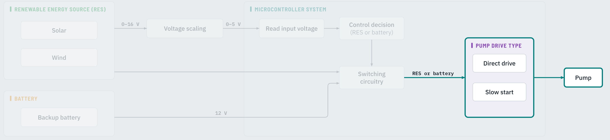
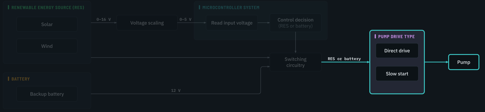
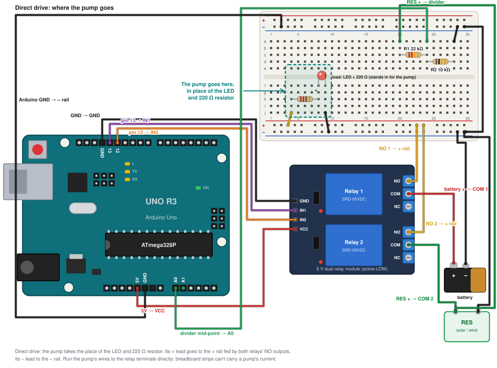
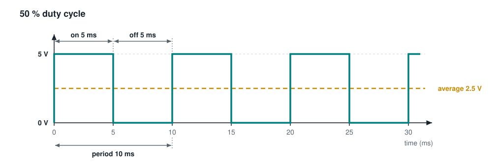
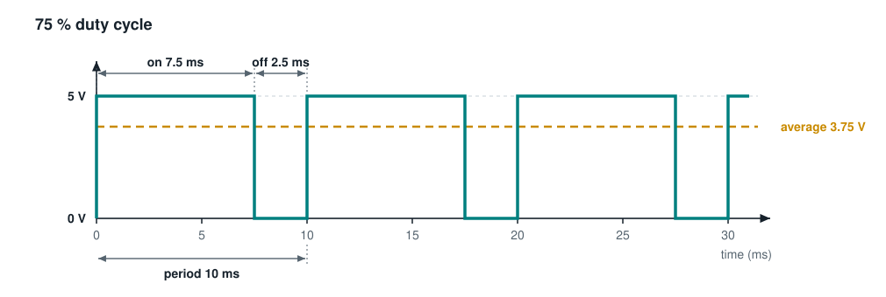

# Pump drive type

The last block in the [project overview](../project-overview.qmd) is the **pump
drive type**: how the selected supply is applied to the pump. This chapter starts
with the simplest way, the one the relay prototype already uses:

- **Direct drive:** the pump is connected straight to the supply the relays
  select, so it gets the full voltage the moment that supply is switched in.

Direct drive needs nothing more than the relays and the switch-over sketch, so it
is where the project starts. Its weak point is the **inrush current**: the surge
a motor draws when it starts, or when its supply suddenly jumps. The second half
of the chapter shows the fix:

- **Slow start:** the pump is driven through a motor driver (an **L298N
  H-bridge** module), and the Arduino ramps its voltage up with **PWM** over a
  second or two.

```{=html}
<figure class="flow-diagram">
<figcaption>System overview · Pump drive type</figcaption>
<a class="fd-light" href="images/system-pump-drive-light.png"></a>
<a class="fd-dark" href="images/system-pump-drive-dark.png"></a>
</figure>
```

## Learning outcomes

By the end of this chapter you should be able to:

- Explain what direct drive is, and wire a pump for direct drive through the
  relay module
- Write and explain a direct-drive switch-over sketch with hysteresis
- Explain why a DC motor draws a large inrush current at start-up and when its
  supply voltage steps up, and describe the advantages and disadvantages of
  direct drive
- Use PWM and `analogWrite` to vary the average voltage applied to a load
- Wire and control an L298N motor driver module
- Write a non-blocking slow-start ramp, and compare it with direct drive

---

## 1. Direct drive

In **direct drive** the pump is connected straight to the switched supply. There
is no motor driver and no speed control: the relays decide *which* supply the
pump gets, and the pump runs at whatever voltage that supply gives.

- RES selected → the pump runs at the RES voltage (e.g. 8–10 V, varying with
  the wind or sun).
- Battery selected → the pump runs at the battery voltage (e.g. 12 V).
- Neither selected → the pump stops.

It is exactly the switch-over circuit from [Switching
circuitry](04-switching-circuitry.md#the-switch-over-with-relays), with the pump
in place of the LED that stood in for it.

### Wiring the pump to the relays

Build the switch-over circuit as in [Switching
circuitry](04-switching-circuitry.md#building-it), then replace the load:



| Connection | From | To |
|---|---|---|
| RES supply | RES +ve | COM, RES relay (relay 2) |
| Battery supply | Battery +ve | COM, battery relay (relay 1) |
| **Pump supply** | **NO of both relays** (joined) | **Pump (+)** |
| **Pump return** | **Pump (−)** | The common ground rail |
| Common ground | RES −ve, battery −ve, Arduino GND, pump (−) | Breadboard ground rail |
| Relay control | Arduino pins 13 and 12 | IN1 (battery), IN2 (RES) |
| Monitoring | RES +ve → 22 kΩ → (A0) → 10 kΩ → ground | Arduino A0 |

- **Both NO terminals feed the pump.** Only one relay is on at a time, so the pump
  sees either the RES or the battery, never both. With both relays off, the pump
  is disconnected.
- **Check the ratings.** The pump current flows through the relay contacts. The
  usual SRD-05VDC relays are rated 10 A at 30 V DC, plenty for a small pump; the
  breadboard is not, so run the pump wires to the relay terminals directly, not
  through breadboard strips.
- **Fit a flyback diode across the pump** (e.g. a 1N4007, its stripe towards the
  pump's + terminal). A motor's winding stores energy; when a relay opens, the
  diode gives that energy a path instead of letting it spark across the contacts.

### The demo code

The sketch is the switch-over sketch from [Switching
circuitry](04-switching-circuitry.md#the-code), with the [hysteresis from Read input
voltage](03-read-input-voltage.md#hysteresis-stop-the-chatter) added. With a real
pump the hysteresis matters more than with an LED: a pump that starts on the RES
can pull the RES voltage down (see below), and a single threshold would then flip
the supply back and forth.

```cpp
/*
 * Direct drive: run the pump from the renewable energy source (RES) while its
 * voltage is high enough, and from the battery when it drops.
 * Hardware: divider (22 kΩ / 10 kΩ) mid-point -> A0; D12 -> IN2 (RES relay);
 *   D13 -> IN1 (battery relay); 5 V -> VCC; NO of both relays -> pump (+);
 *   pump (-) and all grounds joined.
 */

const uint8_t  kResPin     = A0;       // divider mid-point
const uint8_t  kResRelay   = 12;       // IN2: connects the RES to the pump
const uint8_t  kBatRelay   = 13;       // IN1: connects the battery to the pump
const uint16_t kSampleMs   = 100;
const uint8_t  kRelayOn    = LOW;      // the relay module is active-LOW
const uint8_t  kRelayOff   = HIGH;

// Two thresholds (hysteresis), as analogRead values worked out by the compiler.
const int      kToBattery  = 2300L * 1023 / 5000;   // 2.3 V at A0 -> 470
const int      kToRes      = 2700L * 1023 / 5000;   // 2.7 V at A0 -> 552

// Run the pump from the RES. The battery is disconnected first.
void useRes() {
  digitalWrite(kBatRelay, kRelayOff);
  digitalWrite(kResRelay, kRelayOn);
}

// Run the pump from the battery. The RES is disconnected first.
void useBattery() {
  digitalWrite(kResRelay, kRelayOff);
  digitalWrite(kBatRelay, kRelayOn);
}

void setup() {
  Serial.begin(9600);
  digitalWrite(kResRelay, kRelayOff);    // pump off until we decide
  digitalWrite(kBatRelay, kRelayOff);
  pinMode(kResRelay, OUTPUT);
  pinMode(kBatRelay, OUTPUT);

  if (analogRead(kResPin) < kToRes) {    // start on the battery unless the
    useBattery();                        // RES is clearly good enough
  } else {
    useRes();
  }
}

void loop() {
  int reading = analogRead(kResPin);     // 1. read the RES ...
  Serial.println(reading);

  if (reading < kToBattery) {            // 2. ... then decide
    useBattery();                        // clearly too low
  } else if (reading > kToRes) {
    useRes();                            // clearly recovered
  }
  // Between 470 and 552 nothing changes: the pump stays on its supply.

  delay(kSampleMs);
}
```

**How it works**

- **The pump is just the load.** Nothing in the code drives the pump itself: it
  runs whenever a relay connects a supply. Direct drive *is* the switching code.
- **Off before on.** `useRes()` and `useBattery()` disconnect the old supply
  before connecting the new one, so the RES and the battery are never joined, and
  the pump is without power for only the few milliseconds the relays take to move.
- **Hysteresis.** Below 470 the pump goes to the battery; above 552 it goes back
  to the RES; in between it stays where it is. With the 22 kΩ / 10 kΩ divider
  those readings are about 7.4 V and 8.6 V from the RES.
- **A decision in `setup()`.** The pump starts on a supply straight away: the
  RES if it is clearly good, otherwise the battery.
- **Whole numbers only**, as in [Read input
  voltage](03-read-input-voltage.md#why-whole-numbers-are-better).

> ▶️ **[Run it: the switch-over with hysteresis in the code runner](applets/code-runner.html#p8hys)** — the same logic as the demo code, from Switching circuitry: the supply moves to the battery below 2.3 V (470) and back to the RES only above 2.7 V (552).

### The catch: inrush current

A small DC pump is a permanent-magnet DC motor. While it turns, it acts as a
generator as well as a motor: it produces a **back-EMF**, $E$, that opposes the
supply and rises with speed. The current is set by the difference between the
supply and the back-EMF, across the winding resistance $R$:

$$I = \frac{V - E}{R}$$

- **Running at speed**, $E$ is close to $V$, so only a small current flows: just
  enough to overcome friction and the load of the water.
- **At standstill**, $E = 0$, so the current is limited only by the winding
  resistance (and the wiring):
  $$I_{start} = \frac{V}{R}$$

**Example:** a 12 V pump with a winding resistance of 2 Ω that runs at 0.8 A.
With direct drive, the moment the relay closes it draws $12 / 2 = 6$ A: **more
than seven times** its running current, until it speeds up and the back-EMF
builds. Measure your own pump's winding resistance with a multimeter (with the
pump unpowered) to estimate its start-up current.

#### A switch-over causes a surge too

The same thing happens when the pump is already running and its supply jumps.
Running from the RES at 8 V, the pump's back-EMF settles a little below 8 V. The
relays switch to the 12 V battery, and the extra 4 V appears straight across the
winding resistance:

$$\Delta I \approx \frac{V_{new} - V_{old}}{R} = \frac{12 - 8}{2} = 2\ \text{A}$$

on top of the running current, until the pump speeds up to match. Switching to a
*lower* voltage does the opposite: the current briefly falls (it can even reverse
for a moment) while the pump slows down. Only a step **up** causes a surge.

#### Why the surge matters in this project

- **The RES voltage sags.** A solar panel or small turbine can't deliver amps
  without its voltage dropping. A start-up surge can pull the RES below the
  switch-over threshold, so the Arduino switches to the battery, the RES recovers,
  it switches back, and the pump is hit again: an oscillation that hysteresis
  alone may not stop.
- **Stress on the parts.** The relay contacts, the battery, connectors and wiring
  all carry the peak, and relay contacts that switch a surge arc and wear.
- **Mechanical shock.** A pump that jumps to full speed jolts its mounting and can
  cause **water hammer** in the pipework.

### Advantages and disadvantages of direct drive

| Advantages | Disadvantages |
|---|---|
| **Simple:** no driver, no PWM, no extra code | **Full inrush current** at every start: several times the running current |
| **No extra voltage loss:** the pump gets the full supply voltage | **A surge at every switch-over** to a higher supply |
| **Full torque immediately**, useful for a pump that needs a kick to start | Surges can **sag the RES** below the threshold and cause repeated switching |
| **Silent:** no PWM whine | **Stresses** the relay contacts, battery and wiring; mechanical shock and water hammer |
| The relays stay as they are if the code stops | **No speed control**: the pump runs at whatever the supply voltage gives |

---

## 2. Slow start: the idea

A **slow start** (soft start) raises the pump's average voltage gradually, so
the back-EMF can build as the pump speeds up and the current never jumps far
above its running value.

- **At start-up:** ramp the drive from 0 to 100 % over a set time, e.g. 2 s.
- **At a switch-over to a higher supply:** first **reduce** the drive so the
  pump's average voltage stays about the same, switch the supply, then ramp back
  up to 100 %. For example, running flat out on an 8 V RES and switching to a 12 V
  battery, drop the drive to $255 \times 8/12 = 170$ (about 8 V average from 12 V),
  switch, then ramp.
- **At a switch-over to a lower supply:** no surge, so no ramp is needed.

Cutting the drive before a switch-over also means the relay contacts switch a
smaller current, so they arc less.

A slow start needs two things that direct drive doesn't:

1. A way to make a voltage **between** off and full on: **PWM** (section 3).
2. Something that can switch the pump's current that fast: a **motor driver**,
   here the **L298N** (section 4).

Section 5 puts them together with the relays.

---

## 3. PWM: an average voltage from a digital pin

A slow start needs a voltage that rises gradually. An Arduino pin can only be
**on (5 V)** or **off (0 V)**, but it can switch between them very quickly. That
is **Pulse Width Modulation (PWM)**.

### Duty cycle

The signal alternates between ON and OFF. The proportion of each period that the
signal is ON is the **duty cycle**:

$$\text{Duty cycle (\%)} = \frac{\text{on time}}{\text{period}} \times 100$$

**50 % duty cycle** — on 5 ms, off 5 ms, period 10 ms: $\frac{5}{10}\times100 = 50\%$



**75 % duty cycle** — on 7.5 ms, off 2.5 ms: $\frac{7.5}{10}\times100 = 75\%$



The **average** voltage is $V_{avg} = \text{duty} \times V_{supply}$. An LED
switching this fast looks steadily dimmer; a motor's inertia and inductance
smooth the pulses, so it runs as if it were on the average voltage. That is what
makes PWM a speed control, and a slow start.

### `analogWrite`

`analogWrite(pin, value)` produces PWM on the pins marked `~`: **3, 5, 6, 9, 10,
11** (about 490 Hz, or 980 Hz on pins 5 and 6). The value is 8 bits, 0 to 255:

$$\text{duty} = \frac{\text{value}}{255}, \qquad V_{avg} = V_{supply}\times\frac{\text{value}}{255}$$

| `analogWrite` value | Duty cycle | Average from a 5 V pin |
|---|---|---|
| 0 | 0 % | 0 V |
| 64 | 25 % | 1.25 V |
| 128 | 50 % | 2.5 V |
| 191 | 75 % | 3.75 V |
| 255 | 100 % | 5 V |


> ⚠️ **The pin never outputs a voltage between 0 and 5 V.** It switches between
> 0 V and 5 V; only the *average* lies in between. A multimeter usually shows the
> average, an oscilloscope shows the pin jumping.

> 🔧 **Try it:** [PWM visualiser](applets/pwm.html) — drag the slider to see the waveform, duty cycle and average voltage; click pins to check which support PWM.

### A ramp is a fade

Ramping a pump up is the same code as fading an LED up. Exercise 2b brightens an
LED in steps of 10 (about 0.2 V average) with a `for` loop:

```cpp
/*
 * Exercise 2b: Brighten a red LED from 0 V to about 5 V (average) in steps of
 * about 0.2 V, then dim it back down, using for loops. Repeats forever.
 * Hardware: red LED + 220 Ω resistor from D10 (a PWM pin) to GND.
 */

const uint8_t  kRedPin  = 10;     // PWM (~) pin
const uint16_t kStepMs  = 500;    // time at each brightness (ms)
const int      kPwmStep = 10;     // 10 / 255 x 5 V ≈ 0.2 V (average) per step
const int      kTopPwm  = 255 - (255 % kPwmStep);   // largest multiple of the step: 250

void setup() {
  pinMode(kRedPin, OUTPUT);
}

void loop() {
  for (int pwm = 0; pwm <= kTopPwm; pwm += kPwmStep) {            // brighten
    analogWrite(kRedPin, pwm);
    delay(kStepMs);
  }
  for (int pwm = kTopPwm - kPwmStep; pwm > 0; pwm -= kPwmStep) {  // dim
    analogWrite(kRedPin, pwm);
    delay(kStepMs);
  }
}
```

- **Why `int` and not `uint8_t`?** A `uint8_t` holds only 0 to 255. A counter that
  steps past 255 would **wrap round** to a small number, and the loop could run
  forever.
- **Count in whole `analogWrite` values**, not in `float` volts: 0.2 can't be
  stored exactly, so small errors build up.

This version **blocks**: while the `for` loop runs, the Arduino does nothing else.
For the pump that's not acceptable, because the RES must still be watched during
the ramp. Section 5 does the same ramp with `millis()`, as in [Getting started
with the Arduino](02-arduino.md#blocking-vs-non-blocking-timing).

> ▶️ **[Run it: Exercise 2b in the code runner](applets/code-runner.html#ex2bint)** — watch `pwm` climb in steps of 10, then fall again (try 4× speed).

---

## 4. The L298N motor driver

An Arduino pin can't drive a pump even with PWM: it can only supply 20 mA at 5 V.
A common solution is an **L298N module**, a dual **H-bridge** driver on a small
board with screw terminals. One of its two channels drives the pump.

### Wiring the module

| Module terminal | Connect to | Role |
|---|---|---|
| +12V (motor supply, Vs) | The switched supply: the relays' NO outputs | The supply the pump receives |
| GND | The common ground rail | Shared with the Arduino and the supplies |
| OUT3, OUT4 | The pump | Channel B outputs |
| ENB | Arduino **D9** (a PWM pin), after removing the ENB jumper | Turns channel B on and off: the PWM goes here |
| IN3 | Arduino **D8** | Sets OUT3 high or low |
| IN4 | Arduino **D7** | Sets OUT4 high or low |

Most modules also have a 5 V regulator for their own logic, enabled by a jumper.
With a motor supply of 12 V or less, leave that jumper in and don't connect the
module's 5 V terminal to the Arduino's 5 V.

### How an H-bridge drives a motor

Each output (OUT3, OUT4) can be switched to the supply or to ground, so the pump
can be driven either way round, or stopped:

| ENB | IN3 | IN4 | OUT3 | OUT4 | Pump |
|---|---|---|---|---|---|
| HIGH | HIGH | LOW | Supply | GND | Runs one way |
| HIGH | LOW | HIGH | GND | Supply | Runs the other way |
| HIGH | HIGH | HIGH | Supply | Supply | Brakes: both terminals joined |
| HIGH | LOW | LOW | GND | GND | Brakes: both terminals joined |
| LOW | any | any | off | off | Coasts: outputs disconnected |

To run the pump at a controlled speed: set **IN3 HIGH and IN4 LOW** once to fix
the direction (swap them, or the pump wires, if it runs backwards), then use
`analogWrite` on **ENB**. During each "on" part of the PWM cycle the pump is
driven; during each "off" part the outputs are disconnected and the pump coasts.
The drive level is simply the `analogWrite` value: 0 is off, 255 is full drive.

### Things to know about the L298N

- **Voltage loss.** The L298N uses bipolar transistors, which drop about 2 V in
  total at 1 A (more at higher current). At full drive the pump gets less than in
  direct drive.
- **Current limit.** 2 A continuous per channel, with a short peak of 3 A. A slow
  start keeps the pump within it; the 6 A direct start from section 1 would not.
- **PWM whine.** At about 490 Hz the pump may hum audibly while it ramps.
- **Seeing the inrush.** Put a small resistor (0.1–0.2 Ω, rated for the current) in
  series with the pump's supply and look at the voltage across it with an
  oscilloscope: $V = IR$, so 1 A across 0.2 Ω gives 0.2 V. It is the easiest way to
  *see* the inrush current and compare the two drive types.

---

## 5. Slow start with the L298N

The supply switching is the relay circuit from section 1, with one change: the
relays' NO outputs now feed the L298N's **+12V** (motor supply) terminal instead
of the pump, and the pump moves to the L298N's OUT3 and OUT4. The relays still
choose the supply; the L298N decides how much of it reaches the pump.

### The code

The ramp is **non-blocking**: `loop()` keeps checking the RES while the pump
speeds up, and a switch-over during a ramp is handled straight away. The
switching part is the direct-drive sketch from section 1 with its hysteresis; the
new parts are `setPump()`, `startRamp()` and `updateRamp()`.

```cpp
/*
 * RES / battery switch-over with a slow-started pump.
 * Hardware: divider mid-point -> A0 (R1 = 22 kΩ, R2 = 10 kΩ);
 *   D12 -> IN2 (RES relay), D13 -> IN1 (battery relay), active-LOW module;
 *   relay NO outputs -> L298N +12V; pump on OUT3/OUT4;
 *   D9 -> ENB (PWM, jumper removed), D8 -> IN3, D7 -> IN4; all grounds joined.
 */

const uint8_t  kResPin     = A0;      // divider mid-point
const uint8_t  kResRelay   = 12;      // IN2: connects the RES
const uint8_t  kBatRelay   = 13;      // IN1: connects the battery
const uint8_t  kEnbPin     = 9;       // L298N ENB: a PWM pin
const uint8_t  kIn3Pin     = 8;       // L298N IN3
const uint8_t  kIn4Pin     = 7;       // L298N IN4
const uint8_t  kRelayOn    = LOW;     // the relay module is active-LOW
const uint8_t  kRelayOff   = HIGH;

const float    kRatio      = 0.3125;  // divider fraction: 10k / (22k + 10k); measure yours
const float    kBatteryV   = 12.0;    // battery voltage (measure yours)
const float    kToBatteryV = 8.0;     // RES volts: switch to the battery below this ...
const float    kToResV     = 9.0;     // ... and back to the RES only above this
const float    kAdcVref    = 5.0;
const float    kAdcMax     = 1023.0;

const unsigned long kRampMs   = 2000; // time to reach full drive after a ramp starts
const unsigned long kSampleMs = 100;  // time between RES readings

bool          onBattery    = false;
uint8_t       level        = 0;       // pump drive: 0 (off) to 255 (full)
uint8_t       rampFrom     = 0;       // drive level when the current ramp started
unsigned long rampStartMs  = 0;
unsigned long lastSampleMs = 0;

// The RES voltage, from the A0 reading and the divider fraction.
float readResVolts() {
  return analogRead(kResPin) * (kAdcVref / kAdcMax) / kRatio;
}

// Drive the pump at 'lvl' (0 to 255): the PWM duty cycle on ENB.
void setPump(uint8_t lvl) {
  level = lvl;
  analogWrite(kEnbPin, lvl);
}

// Start a ramp from 'from' up to full drive.
void startRamp(uint8_t from) {
  setPump(from);
  rampFrom    = from;
  rampStartMs = millis();
}

// Move the ramp on. Called on every pass of loop(), so it never blocks.
void updateRamp(unsigned long now) {
  if (level == 255) return;                   // already at full drive
  unsigned long t = now - rampStartMs;        // time since the ramp started
  if (t >= kRampMs) {
    setPump(255);
  } else {
    setPump(rampFrom + (255UL - rampFrom) * t / kRampMs);
  }
}

// Change supply, old relay off before new relay on (break before make).
// If the new supply is higher, first cut the drive so the pump's average
// voltage stays about the same, then let it ramp back up.
void changeSupply(bool toBattery, float vRes) {
  float vOld = toBattery ? vRes : kBatteryV;
  float vNew = toBattery ? kBatteryV : vRes;
  if (vNew > vOld) {
    startRamp((uint8_t)(level * vOld / vNew));
  }
  digitalWrite(toBattery ? kResRelay : kBatRelay, kRelayOff);   // break ...
  digitalWrite(toBattery ? kBatRelay : kResRelay, kRelayOn);    // ... then make
  onBattery = toBattery;
}

void setup() {
  digitalWrite(kResRelay, kRelayOff);   // both relays off until we decide
  digitalWrite(kBatRelay, kRelayOff);
  pinMode(kResRelay, OUTPUT);
  pinMode(kBatRelay, OUTPUT);
  pinMode(kEnbPin, OUTPUT);
  pinMode(kIn3Pin, OUTPUT);
  pinMode(kIn4Pin, OUTPUT);

  digitalWrite(kIn3Pin, HIGH);          // sets the pump's direction
  digitalWrite(kIn4Pin, LOW);
  setPump(0);                           // no drive yet

  onBattery = readResVolts() < kToBatteryV;
  digitalWrite(onBattery ? kBatRelay : kResRelay, kRelayOn);
  startRamp(0);                         // slow start from standstill
}

void loop() {
  unsigned long now = millis();

  // 1. Every 100 ms, read the RES and decide on the supply (with hysteresis).
  if (now - lastSampleMs >= kSampleMs) {
    lastSampleMs = now;
    float vRes = readResVolts();
    if (!onBattery && vRes < kToBatteryV) {
      changeSupply(true, vRes);         // RES clearly too low
    } else if (onBattery && vRes > kToResV) {
      changeSupply(false, vRes);        // RES clearly recovered
    }
  }

  // 2. On every pass, move the pump's ramp on.
  updateRamp(now);
}
```

**How it works**

- **`setPump()`** is the only place that touches the L298N's PWM pin. The rest of
  the code thinks in drive levels, 0 to 255.
- **`startRamp()`** records where and when a ramp begins; **`updateRamp()`** works
  out the level from the time since then:
  $\text{level} = \text{from} + (255 - \text{from}) \times t / T_{ramp}$. The `255UL`
  makes the sum use `unsigned long` maths, because $255 \times 2000$ is too big for
  an `int`.
- **`changeSupply()`** compares the old and new supply voltages. Only a step **up**
  causes a surge, so only then is the drive cut before the switch.
- **Nothing blocks.** Each pass of `loop()` takes well under a millisecond, so the
  RES is checked every 100 ms even in the middle of a ramp.

**Things to set for your hardware**

- `kRatio`, the divider fraction: apply a known voltage across the divider and
  divide the voltage at A0 by it, both measured with a multimeter. Measure
  `kBatteryV` too. (This sketch uses a `float` because it works out the pump's
  average voltage at a switch-over; the switching decision itself could use whole
  numbers, as in [Read input voltage](03-read-input-voltage.md).)
- `kToBatteryV` and `kToResV` from the pump's minimum working voltage.
- `kRampMs`: longer means a smaller surge but a slower start. Watch the current
  with an oscilloscope and lengthen the ramp until the peak is close to the
  running current.

### Advantages and disadvantages of slow start

| Advantages | Disadvantages |
|---|---|
| **Low inrush current:** the current rises with the back-EMF instead of jumping to $V/R$ | **More parts:** a motor driver (here an L298N module) |
| **Smooth switch-overs:** the drive is matched to the new supply, so no surge | **More code**, and it must be non-blocking so monitoring continues |
| **Keeps the RES stable:** no surge to drag it below the threshold, so no false switch-overs | **Voltage loss:** about 2 V in the L298N, so the pump never gets the full supply |
| **Gentler on the relay contacts, battery, wiring and the pump**; no water hammer | **Slower to reach full flow**: the pump takes the ramp time to get going |
| **Keeps the L298N within its 2 A rating** | **PWM whine** from the pump, and some heat in the L298N |
| **Speed control** for free: the same PWM can run the pump slower when less flow is needed | At very low duty cycles the pump may hum without turning |

---

## 6. Direct drive or slow start?

| | Direct drive | Slow start |
|---|---|---|
| **Inrush at start-up** | Full: $V/R$, several times the running current | Small: rises with speed |
| **Surge at a switch-over** | Yes, whenever the supply steps up | No: drive matched, then ramped |
| **Effect on the RES** | Can sag it below the threshold and cause repeated switching | Stays stable |
| **Voltage at the pump** | The full supply | About 2 V less (L298N) |
| **Time to full flow** | Immediate | The ramp time (e.g. 2 s) |
| **Parts and code** | Relays only; switching code only | L298N module; ramp code with `millis()` |
| **Speed control** | None | Yes, with the same PWM |

For a renewable source that can't supply large surges, **slow start** is the
better choice: it protects the source, the switching parts and the pump, and the
cost (a little voltage, and a second or two to reach full flow) is small. Direct
drive suits a stiff supply such as the battery alone, or a pump that struggles to
start at reduced voltage.

---

## Key points

- **Direct drive** connects the pump straight to the supply the relays select: the
  pump is the load on both relays' NO terminals, and the switch-over sketch (with
  hysteresis) is all the code it needs.
- Direct drive is simple and loses no voltage, but a DC motor's current is
  $I = (V - E)/R$: at standstill $E = 0$, so the **inrush current** is $V/R$,
  often several times the running current. A switch-over to a higher supply causes
  a surge too.
- **PWM** sets an average voltage: $V_{avg} = V_{supply} \times \text{value}/255$.
- An **L298N** drives the pump: IN3 and IN4 set the direction, and `analogWrite` on
  ENB sets the drive level.
- A **slow start** ramps the drive up with non-blocking `millis()` code, and cuts the
  drive before switching to a higher supply, keeping the current near its running
  value.
