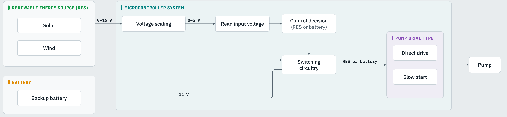
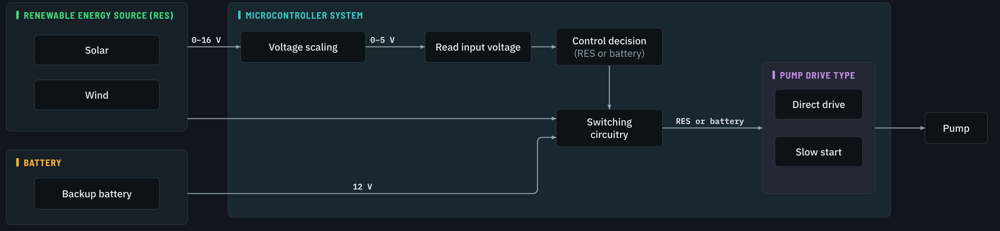
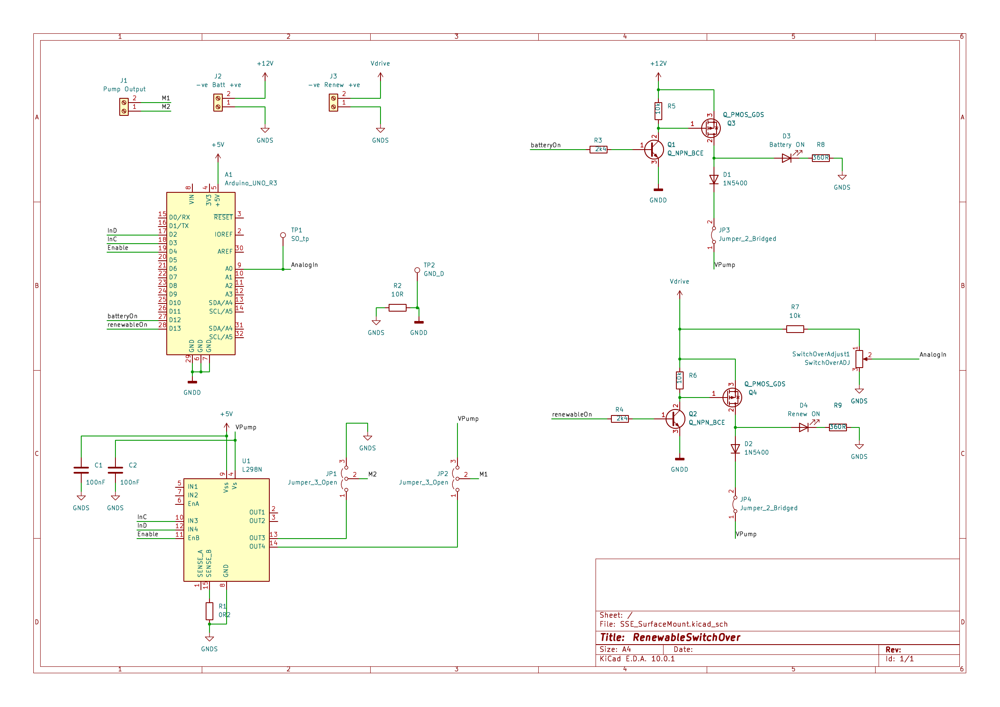

# Advanced: the RenewableSwitchOver board

Chapters 1 to 5 built the system from separate parts on a breadboard: a
resistor divider, an Arduino, a relay module and an L298N module. The
**RenewableSwitchOver** board puts the same system on one circuit board, with
some important differences in how it works. This chapter reads the board's
schematic block by block and matches each part of it to the chapter that
introduced the idea.

```{=html}
<figure class="flow-diagram">
<figcaption>System overview · The whole system</figcaption>
<a class="fd-light" href="images/system-board-light.png"></a>
<a class="fd-dark" href="images/system-board-dark.png"></a>
</figure>
```

## Learning outcomes

By the end of this chapter you should be able to:

- Read the RenewableSwitchOver schematic and find each block of the project
  diagram on it
- Set the board's voltage measurement trimmer safely and measure its divider
  fraction
- Explain how the board's high-side P-MOSFET switches, NPN level shifters and
  diodes select the supply, and compare them with relays
- Explain how the board's L298N and jumpers provide direct drive or slow start,
  and why its PWM goes on IN3
- Program the board, using the pin connections from the schematic

---

## 1. The schematic

[](images/renewable-switchover-schematic.png)


The board itself, rendered from its KiCad layout. Try finding each part from the
schematic on it: the silkscreen names some parts (Q1–Q4, TP1, TP2, R2), and the
others carry their values (2k4, 10k, 360R, 0R2) or labels (Renew ON, Battery
ON, SwitchOverADJ).

A few things help when reading the schematic:

- **Net labels.** A wire ending in a name such as `batteryOn` or `VPump` is
  connected to every other wire with the same name. That is how the Arduino (top
  left) connects to the switches (right) and the L298N (bottom left) without
  wires crossing the sheet.
- **Power symbols.** `+12V`, `+5V` and `Vdrive` are supplies; `GNDS` and `GNDD` are
  two separate grounds (Section 5).
- **Reference designators.** Every part has a name: R for resistors, C for
  capacitors, D for diodes and LEDs, Q for transistors, U for chips, J for
  connectors, JP for jumpers, TP for test points.

---

## 2. The project diagram on the board

| Diagram block | Chapter | On the breadboard | On the board |
|---|---|---|---|
| Renewable energy source (RES) | [Project overview](../project-overview.qmd) | RES wired to the breadboard rails | Screw terminal **J3** (Renew): +ve is the net **Vdrive** |
| Battery | [Project overview](../project-overview.qmd) | Battery wired to the breadboard rails | Screw terminal **J2** (Batt): +ve is **+12V** |
| Voltage scaling | [1 · Voltage measurement](01-voltage-regulation.md) | Fixed divider, e.g. 22 kΩ + 10 kΩ | **R7** (10 kΩ) and the **SwitchOverADJ** trimmer; test point **TP1** |
| Microcontroller system | [2 · Getting started with the Arduino](02-arduino.md) | Arduino Uno | Arduino Uno **A1**, plugged into the board |
| Read input voltage, control decision | [3 · Read input voltage](03-read-input-voltage.md) | Divider mid-point to A0 | Trimmer wiper (net **AnalogIn**) to **A0** |
| Switching circuitry | [4 · Switching circuitry](04-switching-circuitry.md) | Dual relay module, active-LOW | P-MOSFETs **Q3**, **Q4** driven by NPN transistors **Q1**, **Q2**, active-HIGH; diodes **D1**, **D2**; LEDs **D3**, **D4** |
| Pump drive type | [5 · Pump drive type](05-pump-drive-type.md) | Pump on the relays (direct) or on an L298N module (slow start) | **U1** (L298N), selected with jumpers **JP1**, **JP2**; pump on **J1** |

### The Arduino's connections

| Arduino pin | Net | Goes to |
|---|---|---|
| A0 | AnalogIn | Wiper of the SwitchOverADJ trimmer; TP1 |
| D12 | batteryOn | Q1 → Q3: switches the **battery** in |
| D13 | renewableOn | Q2 → Q4: switches the **RES** in (and lights the Arduino's "L" LED) |
| D3 (PWM) | InC | L298N IN3 |
| D2 | InD | L298N IN4 |
| D4 | Enable | L298N EnB |
| 5 V | +5V | L298N logic supply (Vss) |
| GND | GNDD | Driver transistors' emitters; joined to GNDS through R2 |

Compared with the breadboard version, the supply pins are the other way round
(D12 is the battery here, the RES on the relay module), the switches are
active-HIGH, and the L298N uses different pins with its PWM on IN3, not on the
enable pin.

---

## 3. Voltage measurement on the board

The board's divider is the fixed-resistor-plus-trimmer arrangement from
[Voltage measurement](01-voltage-regulation.md#setting-an-adjustable-divider-safely):

| Part | Connection |
|---|---|
| J3 (Renew) | RES +ve (**Vdrive**) and RES −ve (**GNDS**) |
| R7, 10 kΩ | From Vdrive to the top of the trimmer |
| SwitchOverADJ trimmer | Its track from R7 to GNDS; its **wiper** is the net **AnalogIn** |
| AnalogIn | Arduino **A0**, and test point **TP1** (SO_tp) |

With a trimmer of total resistance $R_T$ and $R_{low}$ below the wiper:

$$V_{A0} = V_{RES}\,\frac{R_{low}}{10\ \text{k}\Omega + R_T}$$

> ⚠️ **Set the trimmer before connecting the Arduino.** With a 10 kΩ trimmer turned
> fully up, a 16 V RES puts **8 V** on A0. Check the value printed on your trimmer,
> then:
>
> 1. Connect the largest voltage the RES can produce (or a bench supply set to it,
>    e.g. 16 V) to J3.
> 2. Measure from **TP1** to ground with a multimeter.
> 3. Adjust the trimmer until TP1 reads **just under 5 V** (4.8 V gives a margin).

The trimmer is called **SwitchOverADJ** because it moves the switch-over point:
with a fixed threshold in the code, turning it changes the RES voltage at which
the threshold is reached ($V_{RES} = V_{threshold} / k$).

---

## 4. Reading the input on the board

Because the fraction depends on where the trimmer is set, measure it (the same
idea as measuring the switch-over reading in [Read input
voltage](03-read-input-voltage.md#or-measure-the-reading)):

1. Apply a known RES voltage to **J3**, e.g. 12.0 V from a bench supply, measured
   with a multimeter.
2. Measure the voltage at **TP1**, e.g. 3.60 V.
3. $k = 3.60 / 12.0 = 0.300$. The code keeps it as a whole number of thousandths,
   so it needs no `float`: `const long kRatioPermil = 300;`.

Measure again whenever the trimmer is moved.

---

## 5. Switching circuitry on the board

The board does the relays' job with no moving parts: each supply is switched by
a **P-channel MOSFET**, turned on and off by an **NPN transistor**, and the two
switched supplies are joined through **diodes**. The two switches are identical,
so this section follows the battery side (Q1, Q3, D1, D3); the RES side is Q2,
Q4, D2, D4 with Vdrive in place of +12V.

### High-side P-MOSFET switch: Q3

Q3 sits between the battery's +12V and the pump supply, on the **high side** (the
positive side). Switching the positive side means the pump's negative and the
supplies' negatives stay permanently joined to ground, which keeps the shared
ground the voltage measurement needs.

A **P-channel MOSFET** conducts from source to drain when its gate is pulled well
**below** its source:

- Q3's source is at +12 V. **R5 (10 kΩ)** pulls the gate up to +12 V too, so the
  gate–source voltage $V_{GS} = 0$ and Q3 is **off**.
- To turn Q3 **on**, the gate must be pulled down towards 0 V, giving
  $V_{GS} \approx -12$ V.

### Why the NPN transistor: Q1

The Arduino cannot do that job itself. Its pin only reaches 5 V, so connected
straight to the gate it would hold $V_{GS}$ at about −7 V: Q3 could never turn
**off**, and the 12 V on the gate would reach the Arduino pin. Q1 is a **level
shifter**:

- **batteryOn HIGH:** current flows through **R3 (2.4 kΩ)** into Q1's base:
  $I_B \approx (5 - 0.7)/2400 \approx 1.8$ mA, well within the pin's 20 mA. Q1
  saturates and pulls Q3's gate to almost 0 V. Q3 turns **on**.
- **batteryOn LOW:** no base current, Q1 is off, R5 pulls the gate back to +12 V.
  Q3 turns **off**.

Q1 only has to sink the current through R5: $(12 - 0.2)/10\,000 \approx 1.2$ mA.
Both switches are **active-HIGH**: `digitalWrite(12, HIGH)` connects the battery,
`digitalWrite(13, HIGH)` connects the RES.

> ⚠️ **The gate voltage on the RES side follows the RES.** With the RES at 16 V,
> Q4's $V_{GS}$ is about −16 V. Check the MOSFET's maximum $V_{GS}$ in its
> datasheet (±20 V is common). At a low RES voltage (a few volts) Q4 is only
> partly on, but by then the code should have switched to the battery anyway.

### The diodes: D1 and D2

The drains of Q3 and Q4 feed the pump supply **VPump** through **D1** and **D2**
(1N5400: 3 A, 50 V). The diodes form a **diode-OR**: VPump is fed by whichever
switched-in supply is higher, and the other diode is reverse-biased.

They are there for two reasons:

1. **A MOSFET only blocks in one direction.** Every MOSFET has a body diode from
   drain to source. Without D1, a 16 V RES on VPump would push current back
   through Q3's body diode into the 12 V battery, even with Q3 off. D1 blocks it.
2. **Both supplies can be on at once safely.** With relays, both on means the RES
   and battery are joined directly. With the diodes, current can only flow *out*
   of each supply towards the pump, never from one supply into the other.

The price is a forward voltage drop of roughly 0.8–1 V, which the pump never
gets, and about $P \approx 0.9\,\text{V} \times I$ of heat in the diode.

### Indicator LEDs, jumpers and test points

- **D3 "Battery ON" and D4 "Renew ON"** light when their MOSFET is on, each through
  a 360 Ω resistor (R8, R9), as in the LED circuits of [Getting started with the
  Arduino](02-arduino.md#leds-need-a-series-resistor). At 12 V a red LED draws
  about $(12 - 2)/360 \approx 28$ mA, and with the RES at 16 V about 39 mA. Check
  that is within your LEDs' rating; a larger resistor (e.g. 680 Ω) brings it nearer
  15 mA.
- **JP3 and JP4** (bridged) are in series with each supply's diode. Cut or open
  one to isolate that supply, or to put an ammeter in the path.
- **TP1** is A0 (set the trimmer here). **TP2** is the Arduino's ground.

### Two grounds: GNDS and GNDD

The board has a supply ground, **GNDS** (battery −ve, RES −ve, pump, divider,
L298N), and a digital ground, **GNDD** (the Arduino and the driver transistors'
emitters). They are joined at one point through **R2 (10 Ω)**. The large pump
current returns through GNDS without passing along the Arduino's ground wiring,
while the two grounds stay at the same potential for the A0 measurement.

### Relays or MOSFETs?

| | Relay module (Chapter 4) | MOSFET board |
|---|---|---|
| Switching speed | About 10 ms, with contact bounce | Microseconds, no bounce |
| Wear | Mechanical: contacts wear and arc, especially under load | None |
| Noise | Clicks | Silent |
| Logic | Usually active-LOW | Active-HIGH |
| Voltage lost | Almost none across closed contacts | MOSFET on-resistance plus about 0.9 V across the diode |
| Isolation | Opto-isolators and contacts: no electrical connection to the Arduino | Shares a ground with the Arduino |
| AC or DC | Either | DC only |
| Both supplies on together | **Short circuit** between the supplies: always break before make | Safe, thanks to D1/D2: can make before break |

Because the diodes make it safe for both supplies to be on for a moment, the
board can **make before break**: switch the new supply on *before* the old one
goes off, so the pump never loses its supply during a switch-over. During reset
the Arduino's pins are inputs, so Q1 and Q2 get no base current and both supplies
are off until `setup()` runs.

---

## 6. Pump drive on the board

### The jumpers: choosing the drive type

**JP1** and **JP2** connect the pump terminals (J1: M1, M2) either straight to
the supply or to the L298N's channel B outputs:

| Jumper | Direct drive | Slow start (L298N) |
|---|---|---|
| JP2 → M1 | VPump | OUT4 |
| JP1 → M2 | GND (GNDS) | OUT3 |

Check the positions against the silkscreen on your board. In direct drive, M1 is
the positive terminal and the switching code alone runs the pump, exactly as in
[Pump drive type](05-pump-drive-type.md#direct-drive).

### The board's L298N

| L298N pin | Net | Arduino pin |
|---|---|---|
| IN3 | InC | **D3** (PWM) |
| IN4 | InD | **D2** |
| EnB | Enable | **D4** |
| Vs | VPump | — |
| Vss | +5V | — |
| SENSE_A, SENSE_B | through R1 (0.2 Ω) to GNDS | — |

The L298N module in Chapter 5 takes its PWM on the enable pin. On the board,
**EnB is on D4, which is not a PWM pin**, so the PWM has to go on IN3 (D3, which
is). To run the pump the same way round as direct drive, OUT4 must be the
positive side. With **EnB HIGH and IN4 HIGH**:

- IN3 **LOW**: OUT4 = VPump, OUT3 = GND: the pump is **driven**.
- IN3 **HIGH**: both outputs at VPump: the pump's terminals are joined (brake).

So the drive is the time IN3 spends **LOW**. To drive the pump at a level from 0
to 255, write the inverse: `analogWrite(3, 255 - level)`.

> 💡 If the pump's direction doesn't matter (or you swap its wires for L298N
> mode), hold IN4 **LOW** and write `analogWrite(3, level)` directly. Moving Enable
> to a PWM pin in a future board revision would allow the "PWM on enable" method of
> Chapter 5.

### Other parts around the L298N

- **R1 (0.2 Ω)** is a current-sense resistor: the voltage across it is
  $0.2\,\Omega \times I$, so an oscilloscope across R1 shows the pump current
  (1 A gives 0.2 V). It is the board's built-in way to see the inrush current.
- **C1 and C2** (100 nF) on +5V and VPump smooth the switching spikes.

---

## 7. Code for the board

This combines everything: reading the RES on A0, the switch-over with hysteresis
using the MOSFET switches (make before break), and the slow start through the
board's L298N with the inverted PWM on IN3. It has the same structure as the
sketch in [Pump drive type](05-pump-drive-type.md#the-code); only the pins and
the two hardware functions, `setPump()` and `changeSupply()`, differ.

```cpp
/*
 * RenewableSwitchOver board: supply switch-over with a slow-started pump.
 * Pins from the schematic: A0 = AnalogIn (trimmer wiper),
 *   D13 = renewableOn, D12 = batteryOn (both active-HIGH),
 *   D3 = InC (L298N IN3, PWM), D2 = InD (IN4), D4 = Enable (EnB).
 * Jumpers JP1/JP2 set to the L298N outputs.
 * Whole numbers only: there is no float anywhere in this sketch.
 */

const uint8_t  kSensePin    = A0;
const uint8_t  kResOnPin    = 13;     // renewableOn
const uint8_t  kBatOnPin    = 12;     // batteryOn
const uint8_t  kIn3Pin      = 3;      // InC: a PWM pin
const uint8_t  kIn4Pin      = 2;      // InD
const uint8_t  kEnablePin   = 4;      // Enable (EnB)

// Measured values, kept as whole numbers.
const long     kRatioPermil = 300;    // divider fraction in thousandths, measured at TP1:
                                      //   3.60 V / 12.0 V = 0.300 -> 300
const int      kBatteryMv   = 12000;  // battery voltage in millivolts (measure yours)

// Hysteresis thresholds: RES millivolts, turned into analogRead values by the
// compiler (RES mV x fraction = A0 mV, then x 1023 / 5000).
const int      kToBattery   = 8000L * kRatioPermil / 1000 * 1023 / 5000;  // 8 V -> 491
const int      kToRes       = 9000L * kRatioPermil / 1000 * 1023 / 5000;  // 9 V -> 552

const unsigned long kRampMs   = 2000; // time to reach full drive after a ramp starts
const unsigned long kSampleMs = 100;  // time between RES readings

bool          onBattery    = false;
uint8_t       level        = 0;       // pump drive: 0 (off) to 255 (full)
uint8_t       rampFrom     = 0;       // drive level when the current ramp started
unsigned long rampStartMs  = 0;
unsigned long lastSampleMs = 0;

// The RES voltage in millivolts, from an A0 reading. The sums are done in a
// long, because 1023 x 5000 is far too big for an int.
int resMillivolts(int reading) {
  return (long)reading * 5000 / 1023 * 1000 / kRatioPermil;
}

// Drive the pump at 'lvl' (0 to 255). IN4 is held HIGH, so IN3 LOW drives the
// pump (the same way round as direct drive) and IN3 HIGH doesn't: the drive is
// the time IN3 spends LOW, so write the inverse.
void setPump(uint8_t lvl) {
  level = lvl;
  analogWrite(kIn3Pin, 255 - lvl);
}

// Start a ramp from 'from' up to full drive.
void startRamp(uint8_t from) {
  setPump(from);
  rampFrom    = from;
  rampStartMs = millis();
}

// Move the ramp on. Called on every pass of loop(), so it never blocks.
void updateRamp(unsigned long now) {
  if (level == 255) return;
  unsigned long t = now - rampStartMs;
  if (t >= kRampMs) {
    setPump(255);
  } else {
    setPump(rampFrom + (255UL - rampFrom) * t / kRampMs);
  }
}

// Change supply. If the new supply is higher, first cut the drive so the pump's
// average voltage stays about the same, then let it ramp back up.
void changeSupply(bool toBattery, int reading) {
  int resMv = resMillivolts(reading);
  int oldMv = toBattery ? resMv : kBatteryMv;
  int newMv = toBattery ? kBatteryMv : resMv;
  if (newMv > oldMv) {
    startRamp((long)level * oldMv / newMv);
  }
  // Make before break: diodes D1/D2 stop the supplies feeding each other.
  digitalWrite(toBattery ? kBatOnPin : kResOnPin, HIGH);
  digitalWrite(toBattery ? kResOnPin : kBatOnPin, LOW);
  onBattery = toBattery;
}

void setup() {
  pinMode(kResOnPin, OUTPUT);
  pinMode(kBatOnPin, OUTPUT);
  pinMode(kIn3Pin, OUTPUT);
  pinMode(kIn4Pin, OUTPUT);
  pinMode(kEnablePin, OUTPUT);

  digitalWrite(kIn4Pin, HIGH);        // sets the pump's direction
  setPump(0);                         // no drive yet
  digitalWrite(kEnablePin, HIGH);     // L298N channel B on

  onBattery = analogRead(kSensePin) < kToBattery;
  digitalWrite(onBattery ? kBatOnPin : kResOnPin, HIGH);
  startRamp(0);                       // slow start from standstill
}

void loop() {
  unsigned long now = millis();

  if (now - lastSampleMs >= kSampleMs) {
    lastSampleMs = now;
    int reading = analogRead(kSensePin);
    if (!onBattery && reading < kToBattery) {
      changeSupply(true, reading);    // RES clearly too low
    } else if (onBattery && reading > kToRes) {
      changeSupply(false, reading);   // RES clearly recovered
    }
  }

  updateRamp(now);
}
```

### How the code works

#### The big picture: two jobs at once

The sketch has two jobs, and it must never stop doing either of them:

1. **Watch the RES** and choose the supply: every 100 ms.
2. **Ramp the pump** up smoothly whenever it starts or steps up to a higher
   supply: on every pass of `loop()`.

There is no `delay()` anywhere. Instead, `loop()` runs many thousands of times a
second, and each job checks the time with `millis()` to decide whether it has
anything to do *right now*. This is the non-blocking pattern from [Getting
started with the Arduino](02-arduino.md#blocking-vs-non-blocking-timing). A
`delay(2000)` for the ramp would leave the RES unwatched for two seconds, which is
exactly when a gust or a cloud could need a switch-over.

The code is split into small functions, each doing one thing:

| Function | Job | Called from |
|---|---|---|
| `resMillivolts(reading)` | Turn an A0 reading into the RES voltage in millivolts | `changeSupply()` |
| `setPump(lvl)` | Set the pump's drive level on the L298N | `startRamp()`, `updateRamp()`, `setup()` |
| `startRamp(from)` | Begin a ramp from a given level | `setup()`, `changeSupply()` |
| `updateRamp(now)` | Move the ramp on by the time that has passed | every pass of `loop()` |
| `changeSupply(toBattery, reading)` | Switch the MOSFETs, cutting the drive first if needed | `loop()` |

#### The constants: pins and settings

- **Pins** are named after the schematic's nets: `kResOnPin` is `renewableOn`
  (D13), `kBatOnPin` is `batteryOn` (D12), and the three L298N pins are `InC`
  (D3), `InD` (D2) and `Enable` (D4). If a board revision moves a net, only these
  lines change.
- **`kRatioPermil`** is the divider fraction you measured at TP1 ([Section
  4](#reading-the-input-on-the-board)), in **thousandths**: 0.300 is stored as
  300. **`kBatteryMv`** is your battery's voltage in **millivolts**. Whole units
  like these keep every sum in whole numbers.
- **`kToBattery` and `kToRes`** are the two hysteresis thresholds, worked out by
  the compiler as `analogRead` values: 8 V from the RES puts
  $8000 \times 0.300 = 2400$ mV on A0, a reading of $2400 \times 1023 / 5000 = 491$;
  9 V gives 552. Below 491 switch to the battery, above 552 switch back; between
  them nothing changes. The `L` in `8000L` makes the compiler use `long` maths,
  because $8000 \times 300 = 2\,400\,000$ does not fit in an `int`.
- **`kRampMs`** is how long a ramp from 0 to full drive takes; **`kSampleMs`** is
  how often the RES is read.

#### The variables: what the sketch remembers

| Variable | Remembers | Why it's needed |
|---|---|---|
| `onBattery` | Which supply is switched in | The hysteresis test depends on it: the threshold to cross is different on each supply |
| `level` | The pump's drive level now, 0 to 255 | `changeSupply()` scales it, and `updateRamp()` stops when it reaches 255 |
| `rampFrom` | The level the current ramp started at | A ramp after a switch-over starts part-way up, not from 0 |
| `rampStartMs` | When the current ramp started | `updateRamp()` works the level out from the time since then |
| `lastSampleMs` | When the RES was last read | So it is read every 100 ms, not on every pass |

They are declared outside any function (**global**), so they keep their values
from one pass of `loop()` to the next.

#### No `float`: readings for decisions, millivolts for sums

The sketch never needs a `float`:

- **The decision** compares the raw reading with `kToBattery` and `kToRes`, as in
  [Read input voltage](03-read-input-voltage.md#why-whole-numbers-are-better). No
  conversion is needed at all.
- **The drive scaling** at a switch-over compares the RES and battery *voltages*,
  so `resMillivolts()` turns the reading into whole millivolts:

```cpp
return (long)reading * 5000 / 1023 * 1000 / kRatioPermil;
```

Step by step, for a 12.0 V RES (a reading of about 736):

| Step | Sum | Result |
|---|---|---|
| Reading → mV at A0 | $736 \times 5000 / 1023$ | 3597 mV |
| A0 mV → RES mV | $3597 \times 1000 / 300$ | 11 990 mV, about 12.0 V |

`(long)` makes the whole line use `long` maths: $736 \times 5000 = 3\,680\,000$
would overflow an `int`. **Multiply before dividing** in each step, or the whole
number division would throw the precision away (`5000 / 1023` alone is 4).

Leaving out `float` saves well over 1 KB of program memory, and every sum runs in
a few microseconds ([Read input voltage](03-read-input-voltage.md#why-whole-numbers-are-better)).

#### `setPump()`: the inverted PWM

```cpp
analogWrite(kIn3Pin, 255 - lvl);
```

On the board, IN4 is held HIGH and the PWM goes to IN3 ([Section
6](#the-boards-l298n)). The pump is driven only while IN3 is **LOW**, so the
drive is the inverse of the `analogWrite` value:

| `level` | `analogWrite(3, …)` | IN3 is LOW for | Pump |
|---|---|---|---|
| 0 | 255 | 0 % of the time | Not driven (both outputs at VPump) |
| 64 | 191 | 25 % | Slow |
| 128 | 127 | 50 % | Half drive |
| 255 | 0 | 100 % | Full drive: the whole supply |

`setPump()` is the **only** function that touches the L298N's PWM pin, and it
also records `level`. The rest of the sketch thinks in drive levels, 0 to 255,
and never needs to know about the inversion. On the breadboard, with the PWM on
ENB, only this one line is different.

#### `startRamp()` and `updateRamp()`: a ramp without blocking

`startRamp(from)` sets the pump to `from` and notes the level and the time. It
returns at once; the ramp itself happens in `updateRamp()`, a little at a time:

```cpp
setPump(rampFrom + (255UL - rampFrom) * t / kRampMs);
```

where `t` is the time since the ramp started. The level rises in a straight line
from `rampFrom` when $t = 0$ to 255 when $t$ reaches `kRampMs`. For a start from standstill
(`rampFrom = 0`, `kRampMs = 2000`):

| Time since start | Level | Average voltage on a 12 V supply |
|---|---|---|
| 0 ms | 0 | 0 V |
| 500 ms | 63 | about 3 V |
| 1000 ms | 127 | about 6 V |
| 1500 ms | 191 | about 9 V |
| 2000 ms or more | 255 | 12 V (less the L298N's drop) |

Three details make it work:

- **`255UL`** forces the sum into `unsigned long` maths. $255 \times 2000 = 510\,000$
  is far too big for an `int` (maximum 32 767) and would overflow.
- **Multiply before dividing.** `t / kRampMs` alone would be 0 until the end of the
  ramp (whole-number division), so the level would jump straight from 0 to 255.
- **`if (level == 255) return;`** Once the pump is at full drive, there is nothing
  to do, so `updateRamp()` returns straight away on every later pass.

#### `changeSupply()`: switching without a surge

Only a step **up** in supply voltage causes a surge ([Pump drive
type](05-pump-drive-type.md#a-switch-over-causes-a-surge-too)), so the function
first compares the old and new supply:

```cpp
int resMv = resMillivolts(reading);
int oldMv = toBattery ? resMv : kBatteryMv;
int newMv = toBattery ? kBatteryMv : resMv;
if (newMv > oldMv) {
  startRamp((long)level * oldMv / newMv);
}
```

`? :` picks one of two values: going *to* the battery, the old supply is the RES
and the new one the battery; going back, the other way round.

- **RES → battery** with the pump at full drive on a 7.8 V RES (7800 mV): the new
  supply is higher, so the drive is cut to $255 \times 7800 / 12000 = 165$, in
  `long` maths because $255 \times 7800$ is too big for an `int`. The pump's
  average voltage stays at about 7.8 V, so there is no surge, and the ramp then
  takes it up to 12 V.
- **Battery → RES** at 9.2 V: the new supply is lower, so there is no surge and no
  ramp. The pump simply slows a little.

Then the switch itself, **make before break**:

```cpp
digitalWrite(toBattery ? kBatOnPin : kResOnPin, HIGH);   // new supply on ...
digitalWrite(toBattery ? kResOnPin : kBatOnPin, LOW);    // ... then old supply off
```

For a few microseconds both MOSFETs are on. That is safe on this board because
diodes D1 and D2 stop either supply pushing current into the other, and it means
the pump never loses its supply during a switch-over. With the relay module this
order would short the RES to the battery: that is why the Chapter 4 and 5
sketches do it the other way round.

#### `setup()`: a safe start

The order of the lines matters:

1. **Pins become outputs.** Until now (during reset) they were inputs, so Q1 and Q2
   had no base current and both supplies were off.
2. **IN4 HIGH, then `setPump(0)`**: the direction is set and the pump is not driven
   (IN3 held HIGH) *before* the L298N is enabled.
3. **Enable HIGH**: the L298N's channel B is on, but with no drive yet.
4. **Choose a supply.** If the reading is below `kToBattery` (491), start on the
   battery; otherwise on the RES.
5. **`startRamp(0)`**: the pump starts with a slow start from standstill, never a
   direct start.

#### `loop()`: watching and ramping

```cpp
if (now - lastSampleMs >= kSampleMs) {
```

This is true once every 100 ms. Subtracting the times, rather than comparing
`now` with a future time, keeps working when `millis()` rolls over to 0 after
about 49 days.

Inside it, the hysteresis test uses `onBattery`:

- **On the RES**, only one thing matters: has the reading dropped below 491 (8 V)?
  If so, change to the battery.
- **On the battery**, only: has it recovered above 552 (9 V)? If so, change back.

A RES wobbling between 8 and 9 V therefore causes no switching at all. The
reading is passed on to `changeSupply()`, so the decision and the drive scaling
use the same sample. Finally,
outside the 100 ms test, **`updateRamp(now)`** runs on every pass, so a ramp keeps
moving even while the RES is being read.

#### A run-through

| When | What the RES does | What the sketch does |
|---|---|---|
| Power-up | 12 V (reading 736) | `setup()` picks the RES (736 is not below 491) and starts a ramp from 0 |
| 0–2 s | 12 V | `updateRamp()` takes the drive from 0 to 255; the RES is read every 100 ms and nothing changes |
| 30 s | Drops to 8.5 V (522) | Not below 491: no change (in the dead band) |
| 31 s | Drops to 7.8 V (478) | Below 491: `changeSupply(true, 478)`, about 7790 mV. The battery is higher, so the drive is cut to 165, the battery switched in, then the RES out; the ramp takes 165 back to 255 |
| 40 s | Recovers to 8.8 V (540) | On the battery, and not above 552: no change |
| 41 s | Recovers to 9.2 V (564) | Above 552: `changeSupply(false, 564)`. The RES is lower, so no ramp: switch the RES in, the battery out; the pump carries on at full drive, a little slower |

**What differs from the breadboard sketch**

| | Breadboard (Chapter 5) | Board |
|---|---|---|
| Supply pins | D12 = RES, D13 = battery | D12 = battery, D13 = RES |
| Supply logic | Active-LOW relays | Active-HIGH MOSFET switches |
| Switch-over order | Break before make | Make before break |
| PWM pin | ENB on D9 | IN3 on D3 (EnB on D4 held HIGH) |
| `setPump()` | `analogWrite(9, level)` | `analogWrite(3, 255 - level)` |
| Divider fraction | Calculated from R1, R2 (or measured) | Measured at TP1, stored in thousandths |
| Numbers | `float` volts | Whole numbers only: readings and millivolts |

For **direct drive**, move JP1/JP2 to the direct positions: the L298N is then
bypassed, and only the supply switching matters.

---

## Key points

- The board is the same system as Chapters 1–5: every block of the project diagram
  has a matching group of parts on the schematic.
- **Voltage measurement:** R7 and the SwitchOverADJ trimmer feed A0. Set it at TP1 so
  the RES maximum gives just under 5 V, and measure the fraction there.
- **Switching:** each supply has a **high-side P-MOSFET** (Q3, Q4) driven through an
  **NPN level shifter** (Q1, Q2): D12 HIGH connects the battery, D13 HIGH connects
  the RES.
- Diodes **D1/D2** block the MOSFETs' body diodes and form a diode-OR, so both
  supplies can be on together safely (make before break), at the cost of about
  0.9 V.
- **Pump drive:** JP1/JP2 choose direct or L298N drive. EnB (D4) isn't a PWM pin, so
  the PWM goes on IN3 (D3), inverted, with IN4 (D2) HIGH.
