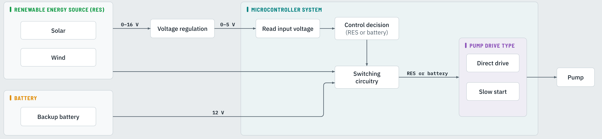
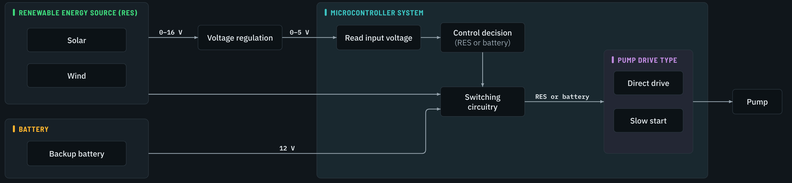

Over the eight chapters you build one working system: an Arduino that watches
the voltage of a **renewable energy source (RES)** and switches the load over to
a **battery backup** when the RES can no longer supply it. Every chapter adds
one piece of that system.

```{=html}
<figure class="flow-diagram">
<figcaption>System overview</figcaption>
<a class="fd-light" href="../assets/project-overview-diagram-light.png"></a>
<a class="fd-dark" href="../assets/project-overview-diagram-dark.png"></a>
</figure>
```

The sections below follow the diagram from left to right, and each one links
to the chapters that cover that part. If you are new to the Arduino, start with
[Arduino basics and LEDs](notes/01-arduino-basics-and-leds.md): the board,
digital outputs and your first circuits.

## Renewable energy source (RES)

Solar panels and a wind turbine supply the system. Their output changes with
the sun and the wind, anywhere from 0 V up to about 16 V, which is the problem
the rest of the system solves: when the RES is too low, the pump has to run
from somewhere else.

## Battery

A 12 V battery is the backup supply. It is not measured: the Arduino only
watches the RES, and switches to the battery when the RES can no longer drive
the pump.

The RES −ve, the battery −ve, the Arduino GND and the pump's negative side are
all joined on one ground rail. A voltage is always measured relative to
something; without the shared ground, `analogRead` has no reference and its
readings are meaningless.

## Voltage regulation

An Arduino analogue pin only accepts 0–5 V, so the 0–16 V from the RES is
scaled down first with a **voltage divider**: two resistors in series across
the RES, with the pin connected to the point between them.

$$V_{pin} = V_{RES} \times \frac{R_2}{R_1 + R_2}$$

With $R_1$ = 22 kΩ and $R_2$ = 10 kΩ, 16 V at the RES gives
16 × 10 / 32 = **5.0 V** at the pin, so the whole RES range fits the Arduino's
input. (This scales the voltage for measuring; it is not a voltage regulator,
and it cannot power anything.)

In the notes:

- [analogWrite, dividers, pots](notes/02-analogwrite-dividers-and-potentiometers.md):
  a first look at voltage dividers.
- [Voltage dividers](notes/05-voltage-dividers.md): choosing the resistors and
  scaling a voltage safely into the Arduino's input range.

## Read input voltage

The divider's mid-point goes to analogue pin **A0**. `analogRead(A0)` returns a
number from 0 to 1023 for 0–5 V, which the code turns back into the RES voltage
by undoing the divider:

```cpp
float resVoltage() {
  int raw = analogRead(A0);              // 0–1023
  float vPin = raw * 5.0 / 1023.0;       // 0–5 V at the pin
  return vPin * (R1 + R2) / R2;          // undo the divider: 0–16 V
}
```

In the notes:

- [Potentiometers](notes/06-potentiometers.md): reading a varying voltage with
  `analogRead`.

## Control decision (RES or battery)

An `if/else` **threshold** in the code decides which supply to use: if the RES
voltage is high enough, use the RES; otherwise use the battery.

A single threshold has one weakness. When the RES voltage hovers right at it,
the decision flips back and forth and the relays chatter. Using two thresholds
(**hysteresis**) avoids that: switch to the battery below one voltage, and only
switch back to the RES once it has risen clearly above it.

```cpp
if (!onBattery && vRes < SWITCH_TO_BATTERY) selectSupply(true);      // to battery
else if (onBattery && vRes > SWITCH_TO_RES) selectSupply(false);     // back to RES
```

In the notes:

- [RES with battery backup](notes/08-res-battery-switchover.md): choosing the
  threshold and writing the decision.

## Switching circuitry

Two **relays** connect the pump to either the RES or the battery. Arduino pin
**13** drives IN1, the battery relay, and pin **12** drives IN2, the RES relay.
The NO outputs of both relays join at the pump's supply, so only the relay that
is switched on feeds it.

The two relays must never be on at the same time, or the RES and the battery
are connected directly together. The code always turns one off before turning
the other on (*break before make*).

The final circuit is built in this order:

1. Power and signals from the Arduino to the relay module.
2. RES power in through its relay.
3. Battery power in through its relay.
4. The monitoring system (the voltage divider).
5. All the grounds connected together.

In the notes:

- [Relays](notes/07-relays.md): switching a separate circuit from an Arduino pin.
- [RES with battery backup](notes/08-res-battery-switchover.md): putting the
  divider, threshold and relays together.
- [Finished circuit](notes/finished-circuit.md): the complete wiring and
  Arduino code.

## Pump drive type

Once the switching circuitry has picked a supply, the pump can be started in
one of two ways.

**Direct drive** connects the pump straight to the selected supply at full
voltage. A motor that is standing still has almost no back-EMF, so for a moment
it draws several times its running current: the **inrush current**.

**Slow start** (a *soft start*) ramps the pump's voltage up instead. The
Arduino drives the pump through a logic-level MOSFET on a PWM pin and raises
the duty cycle from 0 to 100 % over a second or two, so the current rises
gradually as the motor speeds up. The MOSFET goes on the low side, between the
pump's negative side and the ground rail, with a flyback diode across the pump.

| | Direct drive | Slow start (PWM ramp) |
|---|---|---|
| **Inrush current** | High: several times the running current at switch-on | Low: rises with the duty cycle as the motor speeds up |
| **Supply voltage dip** | The surge can pull the RES below the threshold, so the control decision switches straight back to the battery | Small, so the decision stays stable |
| **Relay contacts** | Switch the full surge and can arc | Switch with the pump off; the MOSFET takes the load |
| **Battery and wiring** | Short, heavy current peaks | Gentler on the battery and connections |
| **Pump and pipework** | Sudden start: mechanical shock, possible water hammer | Smooth start |
| **Parts** | None beyond the relays | A logic-level MOSFET and a flyback diode across the pump |
| **Code** | Just switch the relay | A PWM ramp; the pump takes a moment to reach full flow |
| **Losses** | None | The MOSFET warms a little while ramping; below a minimum duty cycle the pump may hum without turning |

### Slow start in Arduino code

On each switch-over the code turns the pump off, changes the supply (break
before make), then ramps the PWM duty cycle back up. The pump's MOSFET is on
pin 9, one of the Uno's PWM pins.

```cpp
const int RES_RELAY = 12;      // IN2
const int BAT_RELAY = 13;      // IN1
const int PUMP_PWM  = 9;       // MOSFET gate (PWM pin)

const float R1 = 22000.0;      // divider, top resistor (ohms)
const float R2 = 10000.0;      // divider, bottom resistor (ohms)
const float SWITCH_TO_BATTERY = 11.5;  // volts
const float SWITCH_TO_RES     = 12.5;  // volts: higher, for hysteresis
const unsigned long RAMP_MS   = 2000;  // time to reach full speed

bool onBattery = false;

float resVoltage() {
  int raw = analogRead(A0);
  float vPin = raw * 5.0 / 1023.0;
  return vPin * (R1 + R2) / R2;
}

// Raise the duty cycle from 0 to 255 over RAMP_MS milliseconds.
void softStart() {
  for (int duty = 0; duty <= 255; duty++) {
    analogWrite(PUMP_PWM, duty);
    delay(RAMP_MS / 255);
  }
}

void selectSupply(bool battery) {
  analogWrite(PUMP_PWM, 0);        // pump off before changing supply
  digitalWrite(RES_RELAY, LOW);    // break...
  digitalWrite(BAT_RELAY, LOW);
  delay(50);                       // let both contacts open
  digitalWrite(battery ? BAT_RELAY : RES_RELAY, HIGH);   // ...before make
  delay(50);                       // let the contacts settle
  onBattery = battery;
  softStart();
}

void setup() {
  pinMode(RES_RELAY, OUTPUT);
  pinMode(BAT_RELAY, OUTPUT);
  pinMode(PUMP_PWM, OUTPUT);
  selectSupply(resVoltage() < SWITCH_TO_BATTERY);
}

void loop() {
  float vRes = resVoltage();
  if (!onBattery && vRes < SWITCH_TO_BATTERY) selectSupply(true);
  else if (onBattery && vRes > SWITCH_TO_RES) selectSupply(false);
  delay(200);
}
```

Things to check on your own hardware:

- **Relay module logic.** The code assumes a relay switches on when its input
  is `HIGH`. Many relay modules are *active-low* (on when `LOW`); if yours is,
  swap `HIGH` and `LOW` in `selectSupply`.
- **Thresholds.** 11.5 V and 12.5 V are starting points. Set them from the
  voltage your pump actually needs.
- **Ramp time.** Longer ramps give a smaller inrush current, but the pump takes
  longer to reach full flow. While `softStart` runs, the code is not watching
  the RES; for long ramps, use `millis()` instead of `delay()`.

In the notes:

- [Loops, PWM and alarms](notes/03-loops-pwm-and-alarms.md): `for` loops and
  PWM with `analogWrite`, the two things a soft start is made of.

Each chapter ends with a knowledge check, and the interactive applets let you
try every circuit before you build it.
